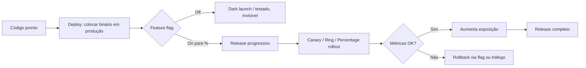
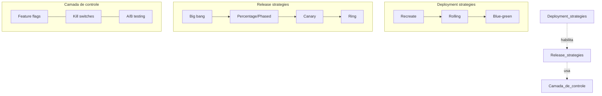
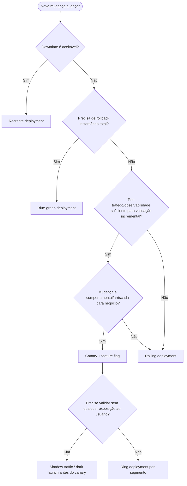

## Resumo executivo
Deployment e release são conceitos distintos que frequentemente são confundidos: deployment é o ato técnico de colocar código executável em um ambiente, enquanto release é o momento em que usuários finais passam a ter acesso a uma funcionalidade. Essa separação — "decouple deployment from release" — é o princípio central do progressive delivery e permite que times técnicos implantem código com frequência sem que isso implique exposição imediata a usuários.[^1][^2][^3]

As estratégias de deployment (recreate, rolling, blue-green) resolvem o problema de "como trocar a versão em execução sem quebrar o serviço"; as estratégias de release (canary, ring, percentage rollout, dark launch, release por cliente/região/dispositivo) resolvem "quem vê a nova funcionalidade e quando"; já feature flags, A/B testing e shadow traffic são ferramentas que operam em uma camada de controle acima do deployment, permitindo ligar/desligar comportamento em runtime sem novo deploy. Kill switches são um tipo específico de flag operacional permanente, distinto de flags de release, que são temporárias.[^2][^3][^4][^5][^6]

Um achado crítico é que feature flags, se não gerenciadas, geram dívida técnica substancial: nomenclatura ambígua, ausência de dono, falta de data de expiração e acúmulo de flags mortas no código são as causas mais citadas. Canários automatizados dependem de métricas objetivas (taxa de erro, latência p99, saturação) analisadas por ferramentas como Flagger ou Kayenta, com critérios matemáticos de promoção/rollback. Testes A/B, por sua vez, falham com frequência por "peeking" (parar o teste antes do tamanho de amostra planejado), amostras pequenas e comparações múltiplas sem correção estatística.[^7][^8][^9][^10][^11][^12][^13][^14][^15]
## Deployment vs. release vs. experimento vs. feature flag vs. controle operacional vs. atualização desktop
| Conceito | O que resolve | Quem controla | Reversibilidade | Exemplo |
|---|---|---|---|---|
| Estratégia de deployment | Como trocar código em execução em infraestrutura | Time técnico / SRE | Depende da estratégia (instantânea a lenta) | Rolling update, blue-green[^1][^2] |
| Estratégia de release | Quando e para quem uma funcionalidade fica visível | Produto / Release manager | Alta (flag toggle) | Canary release, ring deployment[^1][^3] |
| Experimento de produto | Medir impacto de uma mudança no comportamento do usuário | Produto / Growth / Data Science | Alta, mas dados já coletados permanecem | A/B testing[^12][^14] |
| Feature flag | Alternar comportamento em runtime sem deploy | Engenharia/Produto via painel | Instantânea | LaunchDarkly, Unleash, GrowthBook[^16] |
| Controle operacional | Proteger o sistema em produção contra falhas | Engenharia/SRE, geralmente automatizado ou manual de emergência | Instantânea | Kill switch, circuit breaker[^5][^6] |
| Atualização de software desktop | Distribuir binário para máquinas do usuário final, fora do controle direto do backend | Usuário final (parcialmente) e vendor | Lenta, depende de adoção manual/automática | App Store phased release, Windows rings[^17][^18] |

Deployment é sempre controlado por quem opera a infraestrutura; release, por quem define a exposição ao usuário; um experimento de produto usa a infraestrutura de release/flags para gerar dados comparáveis, mas seu objetivo é aprendizado, não apenas segurança. Controles operacionais (kill switches, circuit breakers) são permanentes e reagem a eventos de sistema, diferente de flags de release, que são temporárias e ligadas a um lançamento específico. Atualizações de software desktop são um caso especial: o vendor não controla totalmente quando o binário é instalado, pois depende de comportamento do usuário e de mecanismos de auto-update com rollout escalonado por sistema operacional/loja de aplicativos.[^3][^17][^5][^6][^12]
## Matriz comparativa das abordagens
| Abordagem | Funcionamento | Infraestrutura | Rollback | Impacto em BD | Risco/blast radius | Custo |
|---|---|---|---|---|---|---|
| Big bang release | Todos os usuários recebem tudo de uma vez, sem faseamento | Mínima | Difícil/lenta, exige reversão completa | Alto risco se schema muda junto | Máximo | Baixo |
| Recreate deployment | Derruba tudo, depois sobe nova versão | Mínima (1x) | Rápido, mas com nova janela de downtime | Baixo (sem coexistência de versões) | Total, mas contido a downtime | Muito baixo[^19][^20] |
| Rolling deployment | Substitui instâncias em lotes, sem downtime | Moderada (buffer de capacidade) | Lento, requer reverter lote a lote | Requer compatibilidade retroativa de schema | Gradual, mas atinge todos eventualmente | Baixo-moderado[^21][^4] |
| Blue-green deployment | Dois ambientes completos; troca de tráfego instantânea | Alta (2x durante corte) | Instantâneo (volta ao ambiente antigo) | Requer expand/contract se schema muda | Total após corte, mas reversível na hora | Moderado-alto[^22][^23] |
| Canary release | Pequena fração de tráfego real vai para nova versão; análise de métricas decide promoção | Alta (roteamento por peso, malha de serviço, observabilidade) | Rápido via redirecionamento de tráfego | Requer compatibilidade multi-versão | Pequeno inicialmente | Moderado[^23][^4][^11] |
| Ring deployment | Propagação sequencial por anéis de risco crescente (interno → beta → geral) | Moderada-alta (segmentação de usuários) | Reversível por anel | Igual ao canary | Controlado, aumenta gradualmente | Moderado[^18] |
| Phased/percentage rollout | Percentual fixo de usuários por dia/etapa (ex.: 1%, 2%, 5%...) | Baixa-moderada | Pode pausar, difícil reverter usuários já atualizados | Depende do canal (app stores não fazem downgrade) | Cresce previsivelmente | Baixo[^17] |
| Dark launch | Código roda em produção mas fica invisível/inativo para usuários | Moderada (flags) | Instantâneo (flag off) | Nenhum se sem efeitos colaterais | Zero para usuário | Baixo-moderado[^24][^25] |
| Shadow traffic | Tráfego real é espelhado para nova versão; resposta é descartada | Alta (proxy/mesh de mirror, ex. Envoy/Istio) | N/A (usuário nunca vê) | Alto risco se shadow escrever em BD real | Zero para usuário, mas dobra custo de processamento | Alto (praticamente dobra carga)[^25][^26] |
| A/B testing | Divide tráfego em grupos para comparar métricas de negócio | Alta (plataforma de experimentação, estatística) | Reversível, mas dados de teste podem já ter afetado decisões | Neutro se dados isolados por variante | Moderado (parte dos usuários vê variante inferior) | Moderado[^12][^14] |
| Feature flags | Chave runtime que ativa/desativa código sem deploy | Moderada (servidor/SDK de flags) | Instantâneo | Nenhum direto | Depende do escopo do flag | Baixo, mas gera dívida técnica[^16][^7] |
| Kill switches | Flag operacional permanente para desligar recurso com falha | Baixa (deve funcionar mesmo com outros sistemas fora) | Instantâneo | Nenhum | Reduz risco em incidentes | Baixo[^5][^6] |
| Release por cliente/tenant | Segmentação de exposição por conta/organização | Moderada (flag com regras de tenant) | Por tenant | Isolamento por schema/tenant reduz risco | Contido ao tenant | Moderado |
| Release por região | Segmentação geográfica, útil para compliance/regulação | Moderada (roteamento geo, CDN) | Por região | Pode exigir réplicas regionais de dados | Contido à região | Moderado-alto |
| Release por dispositivo | Segmentação por plataforma (iOS/Android/desktop) | Moderada (flags por client) | Por versão de app | Nenhum direto no backend | Contido à plataforma | Baixo-moderado |
| Deployment desacoplado de release | Deploy do binário ocorre antes/independente da ativação da feature | Alta (arquitetura de flags madura) | Instantâneo (flag) | Depende do design | Controlado, minimiza combinação de riscos | Moderado[^1][^3] |
## Deployment strategies em detalhe
### Big bang release
No big bang, toda a base de usuários recebe a nova versão simultaneamente, sem fases intermediárias. É adequado apenas para aplicações pequenas, internas ou de baixo risco, onde uma eventual falha afeta poucos usuários; é inadequado para sistemas críticos ou de alto tráfego, pois expõe 100% da base ao mesmo tempo sem validação incremental.[^27][^28]
### Recreate deployment
A estratégia recreate encerra completamente a versão antiga antes de iniciar a nova, garantindo ausência de coexistência de versões, mas causando downtime proporcional ao tempo de shutdown e boot. É simples, de baixo custo (nenhuma infraestrutura duplicada) e adequada para ambientes de desenvolvimento, ferramentas internas ou aplicações que não toleram múltiplas versões simultâneas rodando contra o mesmo schema. O rollback também gera downtime, pois exige repetir o ciclo de shutdown/boot com a versão anterior.[^19][^29][^30][^20][^31][^32]
### Rolling deployment
Substitui instâncias antigas por novas em lotes controlados (parâmetros `maxUnavailable`/`maxSurge` no Kubernetes), mantendo disponibilidade contínua. Durante a janela de rollout, versões antiga e nova coexistem servindo tráfego simultaneamente — por isso o código e o schema de banco precisam ser compatíveis entre versões N e N-1. É o padrão default para serviços stateless de baixo risco, mas o rollback é mais lento que blue-green, pois requer reverter a substituição gradualmente.[^22][^21][^4][^20][^33]
### Blue-green deployment
Mantém dois ambientes completos — "blue" (ativo) e "green" (ocioso) — implantando e testando totalmente o green antes de rotear 100% do tráfego para ele. Oferece rollback quase instantâneo (basta reverter o roteador para blue) e permite testes completos antes da exposição, mas custa o dobro de capacidade durante a transição. Mudanças de schema exigem o padrão expand-contract para que ambos os ambientes consigam operar sobre a mesma base de dados sem quebra.[^21][^23][^4][^34][^35][^31]
## Progressive delivery: canary, rings, percentage rollout
### Canary release
Uma pequena fração do tráfego real é direcionada à nova versão, com métricas de sucesso (taxa de erro, latência, saúde de pods) monitoradas antes de aumentar gradualmente a exposição ou reverter. Ferramentas como Flagger e Argo Rollouts automatizam esse ciclo: definem um intervalo de checagem, um peso máximo de tráfego e um limite de falhas de métrica antes de abortar. A fórmula de tempo de promoção é `intervalo × (peso máximo / incremento por passo)`, e o tempo até rollback automático é `intervalo × limite de falhas`. Canary exige observabilidade sofisticada (roteamento ponderado, malha de serviço, dashboards de métricas) e times com disciplina de propriedade sobre os sinais monitorados.[^22][^23][^4][^11][^13]
### Ring deployment
Extensão do canary: em vez de uma única fração de tráfego, define-se uma sequência de "anéis" com tolerância a risco crescente — normalmente ring 0 (equipe interna), depois beta externo, depois geral. É a abordagem usada pela Microsoft no Windows, propagando mudanças progressivamente à medida que a estabilidade é comprovada em cada anel. Rings dão mais controle organizacional que o canary simples, mas exigem segmentação madura de usuários e comunicação clara entre equipes de cada anel.[^18]
### Phased rollout / percentage rollout
Comum em lojas de aplicativos móveis: o Apple App Store, por exemplo, libera automaticamente 1%, 2%, 5%, 10%, 20%, 50% e 100% dos usuários com atualização automática ativada ao longo de sete dias, podendo pausar por até 30 dias no total. Importante: usuários que abrem manualmente a página da loja podem atualizar antes do cronograma, e novos downloads sempre recebem a versão mais recente — o rollout percentual não é uma barreira absoluta. É adequado para aplicativos móveis e desktop distribuídos via canais que o vendor não controla totalmente.[^17]
## Testes em produção sem exposição ao usuário
### Dark launch e shadow traffic
Dark launch implanta código em produção mantendo-o invisível ou inativo para usuários, geralmente controlado por uma feature flag desligada. Shadow traffic (ou traffic mirroring) é o mecanismo técnico por trás de muitos dark launches: uma cópia de cada requisição real é enviada de forma assíncrona ("fire-and-forget") ao serviço candidato, cuja resposta é descartada — o usuário sempre recebe a resposta do serviço em produção. Ferramentas como Envoy e Istio implementam mirroring em nível de proxy, sem alterar código de aplicação.[^36][^37][^24][^25][^38]

O critério de promoção típico exige: taxa de correspondência (match rate) igual ou superior a ~99%, amostra mínima de milhares de requisições, latência p99 do shadow dentro de 10% do controle, taxa de erro não superior à do controle e janela mínima de observação (ex.: 24 horas) para cobrir padrões de tráfego variáveis. O risco central de shadow traffic é efeitos colaterais reais: se o serviço sombra grava em banco, envia e-mails ou processa pagamentos, essas ações afetam dados reais mesmo com a resposta descartada — por isso caminhos de escrita devem ser stubados ou redirecionados para namespaces de teste. Do ponto de vista de proteção de dados, isso implica auditar todo caminho de escrita antes de habilitar shadow traffic, usar headers como `X-Shadow-Request: true` para que serviços downstream retornem respostas simuladas, e nunca deixar caminho de sombra disparar mensagens visíveis ao usuário.[^39][^40][^26][^5][^36]
## A/B testing: rigor estatístico e riscos de diferenças entre grupos
A/B testing divide o tráfego entre variantes para medir impacto em métricas de negócio, mas é propenso a falsos positivos quando mal executado. Os erros mais recorrentes incluem: parar o teste antecipadamente ao ver significância ("peeking"), o que infla drasticamente a taxa de falso positivo; usar amostras pequenas (menos de ~350-1.000 conversões por variante), que produzem resultados instáveis; ignorar efeitos de sazonalidade ao rodar testes por menos de um ciclo semanal completo; efeitos de novidade, em que uma UI redesenhada gera picos de engajamento temporários que não refletem o comportamento estável; descompasso de proporção de amostra (Sample Ratio Mismatch), que indica bug técnico na divisão de tráfego; e segment-snooping — analisar segmentos não pré-especificados após o fato, produzindo "vitórias" espúrias.[^12][^41][^42][^14][^43]

O risco de diferenças estruturais entre grupos vai além da estatística: alocação não verdadeiramente aleatória, distribuição desigual de usuários pesados entre grupos, contaminação cruzada entre tratamento e controle, e padrões diferentes entre observações individuais e agregadas durante o "ramp-up" do experimento são pontos de falha adicionais identificados na literatura de experimentação online. A recomendação consolidada é fixar o tamanho de amostra antes do lançamento, calcular a duração via poder estatístico, correr por ciclos semanais completos e nunca decidir com base em significância intermediária[c2].[^44][^42][^14]
## Feature flags, kill switches e a dívida técnica associada
Feature flags controlam comportamento em runtime sem exigir novo deploy, e se dividem em categorias com ciclos de vida distintos: release toggles (temporários, dias/semanas), ops toggles/kill switches (permanentes), permission toggles (controle de acesso) e experiment toggles (usados em A/B tests). Um kill switch é tipicamente implementado como uma flag invertida — a aplicação assume que a funcionalidade funciona corretamente enquanto a flag estiver desligada, de forma que, mesmo que o sistema de flags fique indisponível, o comportamento padrão seguro prevalece. Um circuit breaker é considerado permanente e ativado por evento (ex.: alerta de monitoramento), diferente do kill switch de curto prazo usado durante um release específico.[^5][^6][^16]
### Dívida gerada por feature flags e remoção de flags antigas
A dívida técnica de flags surge quando toggles permanecem no código muito além de sua utilidade, dificultando leitura, testes e manutenção. As causas mais citadas são: nomes ambíguos que não indicam propósito, quando foram criadas ou quem é responsável; ausência de data de expiração; falta de dono designado; e acúmulo de "mega-flags" que controlam grandes porções do sistema, tornando a remoção arriscada.[^7][^8][^45]

As práticas recomendadas de mitigação incluem:
- Definir data de expiração no momento da criação da flag e criar o ticket/PR de remoção junto com a flag, não depois.[^9][^10]
- Atribuir um dono explícito por flag, responsável por documentar, monitorar e remover.[^8][^10]
- Manter um inventário central de flags (evitar "gavetas de configuração" espalhadas por múltiplos arquivos).[^9]
- Rodar auditorias periódicas verificando: se a flag ainda serve a múltiplas variações ou já está fixada em 100%/0%; se ainda há referências no código; se é uma flag temporária (release/experimento) ou permanente (operacional); e há quanto tempo não foi tocada — mais de ~90 dias sem alteração é sinal de obsolescência.[^10]
- Remover em lotes pequenos e arquivar (não apenas apagar) para preservar trilha de auditoria.[^10]
- Automatizar alertas para flags travadas há mais de 30 dias e bloquear deploys com flags expiradas ainda ativas.[^7]
### Segmentação de usuários
Segmentação — por cliente/tenant, região, dispositivo, ou coortes de risco (rings) — é o mecanismo que torna canary, dark launch e A/B testing operacionalmente viáveis, pois define de forma determinística e auditável quem recebe qual variante. Release por cliente é comum em produtos B2B/multi-tenant, permitindo habilitar recursos por conta antes de expor a toda a base; release por região atende a requisitos regulatórios (ex.: LGPD, GDPR) ou de latência; release por dispositivo isola riscos de compatibilidade entre plataformas (iOS, Android, desktop).[^3][^18]
### Critérios para interromper rollout e análise automática de canary
Os critérios objetivos mais usados por ferramentas de canary analysis incluem: taxa de sucesso de requisições HTTP abaixo de um limite (ex.: 99%), duração média/p99 acima de um teto definido, saúde de pods, e número de falhas consecutivas de checagem de métrica antes de abortar automaticamente. O Flagger, por exemplo, permite configurar `threshold` (número máximo de falhas de métrica antes do rollback), `maxWeight` (peso máximo de tráfego ao canário) e `stepWeight` (incremento por passo), com webhooks para checagens adicionais antes da promoção. A interrupção deve ser automática sempre que possível, pois decisões humanas sob pressão de prazo tendem a ignorar sinais de alerta.[^11][^13]
## Impacto sobre banco de dados: o padrão expand-contract
Independentemente da estratégia de deployment escolhida, mudanças destrutivas de schema (renomear coluna, alterar tipo, tornar campo obrigatório, remover coluna) não podem ser aplicadas em um único passo quando há coexistência de versões de código — o que ocorre em rolling, blue-green, canary e ring deployments. O padrão expand-contract (ou parallel change) resolve isso em três fases:[^34][^46][^47]

1. **Expand** — adicionar novos elementos de schema (colunas, tabelas, índices) sem remover nada existente; código antigo e novo continuam funcionando.[^48][^49][^34]
2. **Migrate** — código passa a escrever nos dois formatos (dual-write) e um job de backfill popula o novo formato com dados históricos, em lotes pequenos para evitar bloqueio de tabelas grandes.[^50][^51][^48]
3. **Contract** — após confirmar que nenhuma versão em produção depende mais do formato antigo, remove-se a estrutura obsoleta.[^52][^49][^34]

A regra prática central é: "o código já em produção sobrevive a esta mudança de schema sem precisar de um novo deploy?" — se a resposta for não, a mudança deve ser dividida em expand e contract. Cada fase deve ser um deploy separado, e migrações nunca devem ser acopladas ao boot da aplicação, para que uma falha de migração não derrube toda a frota de instâncias.[^53][^34][^52]
## Impacto sobre estado e sessões
Deployments que fazem coexistir múltiplas versões (rolling, blue-green, canary) exigem que sessões de usuário e estado em memória sejam compatíveis entre versões, ou que sejam externalizadas (Redis, banco compartilhado) para não se perder durante a troca de instância. Estratégias que fixam o usuário em uma variante (sticky sessions) — comuns em canary, A/B testing e ring deployment — evitam que um mesmo usuário alterne entre versão antiga e nova durante uma única sessão, o que causaria inconsistência de UX. Recreate deployment simplifica esse problema porque elimina a coexistência de versões, mas ao custo de perder qualquer estado não persistido durante a janela de downtime.[^21][^19][^31][^33]
## Observabilidade necessária por abordagem
| Abordagem | Observabilidade mínima exigida |
|---|---|
| Recreate | Health check simples pós-boot |
| Rolling | Saúde de instância individual + taxa de erro agregada |
| Blue-green | Smoke tests completos no ambiente ocioso antes do corte |
| Canary/ring | Métricas de negócio e infraestrutura em tempo real, comparação estatística entre grupos, alertas automatizados[^11][^13] |
| Percentage rollout | Taxa de crash/erro por versão, dashboards de adoção |
| Dark launch/shadow | Taxa de correspondência (match rate), diffs estruturais de resposta, latência comparativa[^36][^26] |
| A/B testing | Cálculo de poder estatístico, monitoramento de SRM, métricas pré-especificadas[^12][^43] |
| Feature flags | Dashboard de estado de flags, alertas de flags obsoletas, dependências entre flags[^10] |
## Diagramas

## Árvore de decisão

## Exemplos apropriados
- Um serviço interno de faturamento usado apenas pela equipe financeira, com janela de manutenção às 2h, usa **recreate deployment** — downtime é aceitável e o custo extra de blue-green não se justifica.[^28]
- Uma fintech muda o algoritmo de scoring de crédito: usa **shadow traffic** por semanas para comparar decisões do novo modelo com o antigo sem impactar clientes reais, só então promove via **canary** com análise automática de métricas.[^36][^54]
- Um app store libera atualização de UI de forma escalonada (1% a 100% em 7 dias) monitorando taxa de crash antes de acelerar o rollout — **percentage rollout**.[^17]
- Uma SaaS B2B habilita um recurso experimental apenas para 3 clientes enterprise que pediram acesso antecipado — **release por cliente** via feature flag com segmentação por tenant.[^3][^16]
- Uma equipe pequena entrega uma feature de checkout: implanta via **rolling deployment**, ativa a feature atrás de um **feature flag** que é ligado gradualmente por percentual, com **kill switch** pronto caso a taxa de erro suba.[^4][^28]
## Exemplos inadequados
- Usar **big bang release** em um sistema de pagamentos crítico sem qualquer fase de validação — expõe 100% dos usuários a um bug catastrófico simultaneamente.[^27]
- Rodar **shadow traffic** sem isolar efeitos colaterais, permitindo que o serviço sombra envie e-mails reais ou realize cobranças duplicadas.[^39][^26]
- Declarar vencedor de um **A/B test** no dia 2 porque o p-valor já passou de 0.05 — peeking problem, altamente propenso a falso positivo.[^42][^14]
- Deixar uma **feature flag** de release sem dono, sem data de expiração, ativa em 100% dos usuários há dois anos — dívida técnica pura, sem benefício de flexibilidade remanescente.[^8][^10]
- Aplicar **recreate deployment** em um serviço de e-commerce de alto tráfego 24/7 sem janela de baixa demanda — downtime direto em receita.[^19][^28]
- Combinar renomeação de coluna com deploy de código em um único passo durante um **rolling deployment** — quebra instâncias antigas que ainda esperam o schema anterior.[^34][^52]
## Combinação de canary e feature flag
A combinação mais recomendada na indústria para mudanças de alto risco é: deploy via rolling/canary na camada de infraestrutura (controla quais instâncias rodam o novo binário) somado a uma feature flag na camada de aplicação (controla quem vê o comportamento novo). Isso separa dois eixos de risco independentes — infraestrutura e comportamento — permitindo reverter cada um isoladamente: se o problema é de infraestrutura (memória, CPU), revertem-se pods; se é de lógica de negócio, desliga-se a flag instantaneamente sem esperar rollback de deployment. Ferramentas como Flagger acoplam essa lógica automaticamente, expondo canários controlados por peso de tráfego e promovendo/revertendo com base em métricas via webhooks configuráveis.[^1][^4][^11][^13][^28]
## Estratégia mínima para equipe pequena
Para uma equipe pequena com baixo orçamento de infraestrutura, o pacote mínimo viável é: rolling deployment como padrão de deploy (sem custo extra de ambiente duplicado), feature flags simples (open-source como Unleash ou GrowthBook) para controlar exposição de novas funcionalidades, e um kill switch básico por funcionalidade crítica. Percentage rollout manual (ex.: 10% → 50% → 100% ao longo de dias, observando erro/latência) substitui um canary automatizado sofisticado quando não há orçamento para malha de serviço e análise estatística automatizada. Big bang deve ser reservado apenas para mudanças de baixíssimo risco (config, copy, correções triviais).[^21][^4][^16][^20][^28]
## Estratégia para produto crítico
Produtos críticos (pagamentos, saúde, infraestrutura de terceiros) devem combinar: blue-green deployment para garantir rollback instantâneo de infraestrutura, shadow traffic para validar comportamento novo sob carga real sem qualquer exposição ao usuário antes de qualquer decisão de promoção, canary com análise automática de métricas (Flagger/Kayenta-style) para expansão gradual controlada por SLOs objetivos, e feature flags com kill switch dedicado e monitorado para cada funcionalidade sensível. Mudanças de schema devem seguir rigorosamente expand-contract, com backups e testes de rollback validados antes de qualquer contract irreversível. Ring deployment é recomendável para propagar a mudança por segmentos de risco crescente (interno → beta → clientes de baixo risco → geral) antes do release total.[^23][^36][^18][^34][^5][^35][^11]
## Estratégia para aplicação desktop
Aplicações desktop (como as do ecossistema CAD mencionado — ZWCAD, SketchUp, Enscape) não têm controle total sobre o momento de adoção pelo usuário, diferente de serviços web. A estratégia recomendada combina: rollout percentual escalonado via mecanismo de auto-update (equivalente ao padrão da Apple: 1%→2%→5%→10%→20%→50%→100%, pausável), canal de release por anéis (interno → beta testers → early adopters → geral), e telemetria opt-in para capturar erros de instalação e ativação de licença antes de acelerar o rollout. Como o deployment desacoplado de release é mais difícil em desktop (o binário só muda de comportamento após reinstalação/atualização local), o uso de feature flags remotas verificadas em runtime (quando há conectividade) é o mecanismo mais próximo disponível para desligar uma funcionalidade problemática sem exigir nova versão instalada — essencialmente um kill switch remoto. Testes A/B em desktop são mais raros e geralmente limitados a cohorts de licença ou canal de distribuição, dado o ciclo de atualização mais lento.[^18][^17][^6][^16]
## Antipadrões
- **Flag soup**: dezenas de feature flags aninhadas sem inventário central, tornando impossível prever o comportamento resultante de combinações.[^7][^9]
- **Peeking estatístico**: parar A/B tests no primeiro sinal de significância, sem sample size pré-calculado.[^42][^14]
- **Shadow traffic com efeitos colaterais reais**: permitir que o caminho sombra grave dados, cobre pagamentos ou dispare notificações.[^39][^26]
- **Recreate em produção crítica**: aplicar a estratégia mais simples e barata onde a SLA de disponibilidade não permite downtime.[^19][^28]
- **Contract prematuro**: remover coluna/tabela antiga antes de confirmar que 100% das instâncias e todos os relatórios/integrações já migraram para o novo schema.[^34][^53]
- **Mega-flag**: uma única flag controlando toda uma feature grande, tornando a remoção arriscada e monolítica em vez de flags pequenas e independentes.[^7]
- **Canary sem métricas objetivas**: promover manualmente "porque parece bom", sem thresholds definidos de erro/latência.[^11][^13]
- **Confundir deployment com release**: assumir que "já foi deployado" significa "já está liberado para todos", ignorando a possibilidade de flags desligadas.[^1][^3]
## Checklist
- [ ] O deploy está desacoplado do release via feature flag?[^1][^3]
- [ ] Existe kill switch testado para toda funcionalidade de risco elevado?[^5][^6]
- [ ] Toda flag tem dono, nome claro e data de expiração definida na criação?[^7][^10]
- [ ] Mudanças de schema seguem expand-contract com deploys separados?[^34][^47]
- [ ] Canário tem thresholds objetivos de métrica e rollback automatizado configurado?[^11][^13]
- [ ] Shadow traffic tem caminhos de escrita auditados/stubados?[^39][^26]
- [ ] Tamanho de amostra do A/B test foi calculado antes do lançamento, sem peeking?[^42][^14]
- [ ] Existe plano de rollback testado, não apenas teórico, para cada estratégia de deployment usada?[^52][^34]
- [ ] A segmentação de usuários (tenant/região/dispositivo) está documentada e auditável?[^3][^18]
- [ ] Há processo recorrente (sprint/quarter) de auditoria e remoção de flags obsoletas?[^45][^10]
## Tabela de fontes e limitações
| Fonte | Tipo | Escopo coberto | Limitação |
|---|---|---|---|
| LaunchDarkly[^1] | Documentação de vendor | Diferença deploy/release, flags operacionais | Viés comercial pró-flags |
| CircleCI, Oracles.Cloud, PandaStack, Spot Rackspace, CloudZero[^2][^22][^21][^55][^28] | Blogs técnicos de engenharia (2026) | Comparação de deployment strategies | Conteúdo recente sem revisão por pares; alguns com marketing de produto |
| Flagger docs, oneuptime[^11][^13] | Documentação oficial de ferramenta open-source | Canary analysis automatizada | Específico à ferramenta (Flagger/Kubernetes); outras ferramentas variam |
| Evan Miller, CXL, Towards Data Science[^14][^41][^44] | Especialistas em estatística/CRO | Pitfalls estatísticos de A/B testing | Foco majoritariamente em web/CRO, menos em mobile/backend |
| Growthbook, Statsig, Flagshark, Unleash, Harness[^10][^7][^8][^16][^56] | Vendors de feature flag | Dívida técnica de flags e boas práticas | Cada vendor promove seu próprio produto de gestão de flags |
| Microsoft Learn[^18] | Documentação oficial | Ring deployment | Focado em contexto Microsoft/Windows, generalização parcial |
| itsyconnect, Apple App Store docs[^17] | Blog especializado em App Store | Phased rollout mobile | Específico à Apple; Google Play tem mecanismo similar mas não detalhado aqui |
| Vários blogs sobre expand-contract (prisma, deployhq, enolcasielles)[^34][^47][^53] | Blogs técnicos e guias de engenharia | Padrão expand-contract para banco de dados | Convergência forte entre fontes, mas nenhuma é acadêmica formal exceto a tese[^35] |
| Tese de mestrado Utwente[^35] | Acadêmica | Zero-downtime schema migration | Fonte acadêmica única, escopo limitado a bancos relacionais |

Não foi possível localizar documentação específica sobre release por região com foco em conformidade regulatória detalhada (ex. LGPD/GDPR aplicado a rollout), nem estudos quantitativos independentes sobre o percentual real de times que usam automação completa de canary analysis versus decisão manual — essas lacunas foram inferidas a partir de práticas gerais da indústria, não de dados diretamente medidos.

---

## References

1. [Deployment and release strategies](https://launchdarkly.com/docs/guides/infrastructure/deployment-strategies) - In this guide, we'll explore: The difference between deployment and release; Different deployment an...

2. [Deployment strategies: Types, trade-offs, and how to choose](https://circleci.com/blog/deployment-strategies-types-trade-offs-and-how-to-choose/) - Deploying means putting code into an environment. Releasing means exposing that code to users. Some ...

3. [The Two Pillars of Software Delivery: Release & ...](https://www.linkedin.com/pulse/two-pillars-software-delivery-release-deployment-satya--7zmhc) - Release vs Deployment Strategy. A Release strategy focuses on validating the software before or duri...

4. [Safe Deployment Strategies: Blue-Green, Canary, and Rolling](https://dev.to/beefedai/safe-deployment-strategies-blue-green-canary-and-rolling-1okk) - Compare blue-green, canary, and rolling deployments and when to use feature flags. Automate rollouts...

5. [Operational Feature Flags Best Practices](https://launchdarkly.com/blog/operational-flags-best-practices/) - A kill switch typically refers to a short-term flag used during a release to turn a feature off if s...

6. [Feature Flags and Kill Switches - Debugging Under Pressure](https://nemorize.com/roadmaps/debugging-under-pressure/lessons/feature-flags-and-kill-switches) - Using runtime toggles to disable problematic features Free lesson from the Debugging Under Pressure ...

7. [Managing feature flag technical debt](https://www.statsig.com/perspectives/feature-flag-debt-management) - Learn how to manage feature flags effectively to prevent technical debt. Discover best practices and...

8. [The Complete Guide to Managing Feature Flag Technical ...](https://flagshark.com/blog/feature-flag-technical-debt-guide/) - Learn to identify, prevent, and eliminate feature flag technical debt. Practical strategies to save ...

9. [3 Ways to Avoid Technical Debt when Feature Flagging](https://launchdarkly.com/blog/3-ways-to-avoid-technical-debt-when-feature-flagging/) - feature flags technical debt

10. [How engineering teams reduce feature flag technical debt](https://www.growthbook.io/blog/engineering-guide-feature-flag-technical-debt) - Feature flag technical debt slows down your team and increases risk. Learn how to detect stale flags...

11. [Deployment Strategies](https://docs.flagger.app/usage/deployment-strategies) - When skip analysis is enabled, Flagger checks if the canary deployment is healthy and promotes it wi...

12. [A/B Testing: Sample Size, Significance, and Common Pitfalls](https://woobox.com/articles/ab-testing-sample-size-and-significance) - A/B testing fundamentals — sample size math, statistical significance, peeking, novelty effects, and...

13. [How to Use Canary Analysis Automated Rollback Tests ...](https://oneuptime.com/blog/post/2026-02-09-canary-analysis-rollback-flagger/view) - In this guide, we'll configure Flagger for automated canary deployments with metric-based analysis, ...

14. [How Not To Run an A/B Test](https://www.evanmiller.org/how-not-to-run-an-ab-test.html) - Are you falling victim to the peeking problem? Learn how to design and run an experiment properly.

15. [10 Common AB Testing Mistakes To Avoid In 2023 ...](https://www.awa-digital.com/blog/ab-testing-mistakes/) - Mistake 1: Running Tests Without A Hypothesis · Mistake 2: Ignoring Statistical Significance · Mista...

16. [What is a feature flag and why are feature flags used?](https://docs.getunleash.io/get-started/what-is-a-feature-flag) - Release, experiment, kill switch, operational, permission, and sunset flags each address a different...

17. [App Store phased release: how the 7-day rollout really works](https://itsyconnect.com/guides/app-store-phased-release) - The phased release schedule (1%, 2%, 5%, 10%, 20%, 50%, 100% over seven days), what pausing does and...

18. [Explore CI-CD with deployment rings - Training | Microsoft Learn](https://learn.microsoft.com/en-us/training/modules/implement-test-progressive-exposure-deployment/3-explore-ci-cd-deployment-rings) - Explore CI-CD with deployment rings

19. [7 Kubernetes Deployment Strategies: Pros, Cons, And ...](https://octopus.com/devops/kubernetes-deployments/kubernetes-deployment-strategies/) - strategy.type: Recreate : All existing pods are terminated before new pods are created. This ensures...

20. [Kubernetes Deployment Strategies: Pros, Cons & Use Cases](https://www.qovery.com/blog/kubernetes-deployment-strategies) - ... Recreate is simple and resource-efficient but causes complete application downtime. The choice o...

21. [Deployment Strategies Compared: Rolling, Canary, Blue-Green](https://pandastack.io/blog/deployment-strategies-compared) - Deploy static sites, containers, databases, cron jobs, and edge functions — all from GitHub. PandaSt...

22. [Blue-Green vs Canary vs Rolling Deployments - Oracles.Cloud](https://oracles.cloud/blue-green-vs-canary-vs-rolling-deployments-which-release-strategy-fits-your-risk-profile) - A practical comparison of blue-green, canary, and rolling deployments to help teams match release st...

23. [Canary release vs rolling deployment: Rollback speed, risk ...](https://www.getunleash.io/blog/canary-release-vs-rolling-deployment) - Learn how canary and rolling deployments improve software delivery with safer rollouts, instant roll...

24. [What is Dark Launch and How to Test it?](https://testrigor.com/blog/what-is-dark-launch-and-how-to-test-it/) - Dark launch and canary testing enable teams to assess how new functionality impacts system performan...

25. [What Is Dark Launching? Test Features Safely](https://www.growthbook.io/insights/dark-launching) - Shadow traffic can expose rare payloads, production traffic distributions, performance bottlenecks, ...

26. [[BEE-16007] Grey and Dark Releases, and A/B Testing](https://alivedise.github.io/backend-engineering-essentials/cicd-devops/grey-and-dark-releases-and-a-b-testing) - Backend Engineering Essentials documentation

27. [The Ultimate Guide to Deployment Strategies: Blue-Green ...](https://medium.com/@nikoo.asadnejad.work/the-ultimate-guide-to-deployment-strategies-blue-green-canary-rolling-and-beyond-a5b916aed693) - Learn the top software deployment strategies — Recreate, Rolling, Blue-Green, Canary, Shadow, A/B Te...

28. [Deployment strategies explained: types, trade-offs, and costs](https://www.cloudzero.com/blog/deployment-strategies/) - A complete guide to the 6 core deployment strategies, from blue-green to canary to shadow, including...

29. [5 Deployment Strategies: The Pros and Cons](https://thenewstack.io/5-deployment-strategies-the-pros-and-cons/) - The main downside of the recreate strategy is the downtime. Requests made during the deployment will...

30. [Deployment Strategies - Recreate: The Simplest Strategy (And When It's Actually the Right Choice) |](https://www.youtube.com/watch?v=Rq46UPLJRUo) - Most teams skip straight to fancy deployment strategies — but understanding Recreate first is what m...

31. [Deployment Strategies | Baeldung on Ops](https://www.baeldung.com/ops/deployment-strategies) - Learn what are deployment strategies and compare six different strategies.

32. [Top 6 Kubernetes Deployment Strategies](https://devtron.ai/blog/top-6-kubernetes-deployment-strategies/) - Deployment Strategy. Reasons to Use ; Recreate. When downtime is acceptable or during development. W...

33. [8 Kubernetes Deployment Strategies: Pros, Cons & Use ...](https://www.groundcover.com/blog/kubernetes-deployment-strategies) - In this approach, the old pods are terminated first, which can cause cluster downtime during the upd...

34. [Zero-Downtime Database Migrations: The Expand-Contract Guide](https://blog.theappcode.net/zero-downtime-database-migrations) - Ship schema changes to a live database with no outage. The expand-contract pattern for adding, renam...

35. [Zero Downtime Schema Migrations in Highly Available Databases](http://essay.utwente.nl/92098/1/vanKampen_MA_EEMCS.pdf)

36. [Dark Launch System Low-Level Design: Shadow Traffic ...](https://www.techinterview.org/post/3233468857/lld-dark-launch/)

37. [Build a Shadow Traffic / Dark Launch System - Scalable System](https://scalablesystem.dev/system-design/build-a-shadow-traffic--dark-launch-system) - Design a traffic mirroring system that duplicates live production requests to a canary service in re...

38. [Traffic Mirroring & Dark Launch Testing in Kubernetes: Zero-Risk ...](https://mdsanwarhossain.me/blog-traffic-mirroring-dark-launch.html) - Learn traffic mirroring and dark launch strategies in Kubernetes with Envoy and Istio. Validate new ...

39. [[BEE-15006] Testing in Production](https://alivedise.github.io/backend-engineering-essentials/testing/testing-in-production) - Backend Engineering Essentials documentation

40. [Dark Launching New Architecture: A Data-Driven Guide to Zero-Risk Deployment – Software Modernization Intelligence](https://softwaremodernizationservices.com/blog/dark-launching-new-architecture/) - Learn how to use dark launching new architecture to safely deploy major changes. Reduce risk and val...

41. [12 A/B Testing Mistakes I See All the Time - CXL](https://cxl.com/blog/12-ab-split-testing-mistakes-i-see-businesses-make-all-the-time/) - A/B testing is fun. But you have to do it right if you expect results. Find out how to avoid the mos...

42. [A/B Testing That Actually Works (Most of Yours Don't) | easy.bi Blog](https://www.easy.bi/blog/ab-testing-best-practices/) - Only 1 in 8 A/B tests produces statistically significant results. Learn the math behind reliable tes...

43. [How to avoid common data accuracy pitfalls in A/B testing](https://www.kameleoon.com/blog/data-accuracy-pitfalls-ab-testing) - Studies with small samples tend to be underpowered meaning they don't have enough power to accuratel...

44. [8 Common Pitfalls of Running A/B Tests | Towards Data Science](https://towardsdatascience.com/online-controlled-experiment-8-common-pitfalls-and-solutions-ea4488e5a82e/) - How not to fail your online controlled experimentation

45. [Technical Debt Management with Feature Flags: Strategy & Best Practices - DevOps.com](https://devops.com/technical-debt-management-with-feature-flags-strategy-best-practices/) - Technical debt is accumulated as unmanaged flags accrue in an application’s code. And the associated...

46. [Zero-Downtime Database Migrations: The Expand/Contract ...](https://codewisdom.io/blog/programming-basic-programming-thoughts-api-database-synchronization/) - Deploying code and schema changes together is fragile — a failed deploy leaves code and schema out o...

47. [Database Migration Strategies for Zero-Downtime ...](https://www.deployhq.com/blog/database-migration-strategies-for-zero-downtime-deployments-a-step-by-step-guide) - A practical guide to zero-downtime database migrations for teams managing stateful applications. Inc...

48. [Zero-downtime database migrations: the expand-contract ...](https://matthewpalma.dev/blog/zero-downtime-database-migrations-expand-contract-pattern) - Ship relational schema changes without maintenance windows using expand-contract phases, backfills, ...

49. [Prisma Migrations in Production: Zero-Downtime Deployments With ...](https://dev.to/whoffagents/prisma-migrations-in-production-zero-downtime-deployments-with-expand-contract-2l1p) - Prisma migrations can take your app down if done wrong. Running prisma migrate deploy on a live...

50. [Zero-Downtime Database Migration: Expand-Contract, EF Core ...](https://anhtu.dev/zero-downtime-database-migration-expand-contract-ef-core-batch-backfill-production-1151) - Zero-downtime database migration strategies for .NET 10 and SQL Server: Expand-Contract pattern, EF ...

51. [Zero Downtime Database Migration with Expand/Contract Pattern](https://www.linkedin.com/posts/danish-mehmud_database-migrations-zerodowntime-activity-7431145182319943680-lHyU) - 𝐙𝐞𝐫𝐨 𝐃𝐨𝐰𝐧𝐭𝐢𝐦𝐞 𝐃𝐚𝐭𝐚𝐛𝐚𝐬𝐞 𝐌𝐢𝐠𝐫𝐚𝐭𝐢𝐨𝐧𝐬: 𝐓𝐡𝐞 𝐄𝐱𝐩𝐚𝐧𝐝/𝐂𝐨𝐧𝐭𝐫𝐚𝐜𝐭 𝐏𝐚𝐭𝐭𝐞𝐫𝐧 𝐟𝐨𝐫 𝟏𝟎𝟎𝐌+ 𝐑𝐨𝐰𝐬 🚀 "Just run 𝐀𝐋𝐓𝐄𝐑 𝐓𝐀𝐁𝐋...

52. [Zero-Downtime Database Migrations: Expand-Contract Pattern](https://scopeforged.com/blog/database-migration-zero-downtime) - The expand-contract pattern (sometimes called parallel change) solves this by breaking dangerous sch...

53. [Database Migrations. The Expand-Contract Pattern](https://www.enolcasielles.com/en/blog/database-migrations-strategy) - Let's see how this problem could be addressed safely and without downtime. The solution involves usi...

54. [Canary & Shadow Testing for ML Models - ApX Machine Learning](https://apxml.com/courses/monitoring-managing-ml-models-production/chapter-4-automated-retraining-updates/advanced-deployment-patterns)

55. [Deployment Strategies: A Comprehensive Guide for 2026](https://spot.rackspace.com/blog/deployment-strategies) - Explore every major deployment strategy, rolling, blue-green, canary, and more, with trade-offs, too...

56. [Managing technical debt](https://developer.harness.io/docs/feature-management-experimentation/admin-best-practices/managing-technical-debt) - How to reduce flag debt​ · Create a clean-up ticket when you create the flag​ · Set an expiration da...

