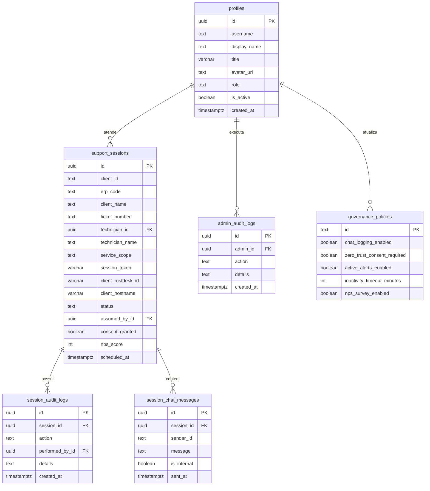

# Guia Oficial de Migrações, Schemas e Integração Supabase Cloud
**Projeto:** Totalcad Viewer (RustDesk Core)  
**Autor:** Equipe de Engenharia de Software & Dados  
**Data:** 27/08/2026  
**Status:** HOMOLOGADO  

---

## 1. Visão Geral da Infraestrutura

O **Totalcad Viewer** utiliza a nuvem do **Supabase** como backend relacional, autenticação gerenciada e mensageria em tempo real.

- **Projeto Oficial:** `jyjqzwiothwpbfsvtjmv`
- **URL Base:** `https://jyjqzwiothwpbfsvtjmv.supabase.co`
- **Engine:** PostgreSQL 17.6
- **Gateway:** PostgREST 14.17 + GoTrue + Realtime WebSockets

---

## 2. Estrutura de Tabelas e Governança de Dados



---

## 3. Higiene de Credenciais e Segurança (.env)

1. **Nunca comitar segredos:** As chaves `service_role` e o token de gerenciamento `sbp_...` devem residir exclusivamente no `.env` local.
2. **Gitignore Obrigatório:** Os arquivos `.env`, `.env*.local` e `*.env` devem constar no `.gitignore`.
3. **Template .env.example:** Sempre manter o `.env.example` atualizado na raiz e subpastas de apps.

---

## 4. Comandos de Automação MCP e Agent Skills

```bash
# Adicionar Servidor MCP
claude mcp add --scope project --transport http supabase "https://mcp.supabase.com/mcp?project_ref=jyjqzwiothwpbfsvtjmv&features=docs%2Caccount%2Cdatabase%2Cdebugging%2Cdevelopment%2Cfunctions%2Cbranching"

# Instalar Agent Skills
npx skills add supabase/agent-skills
```
