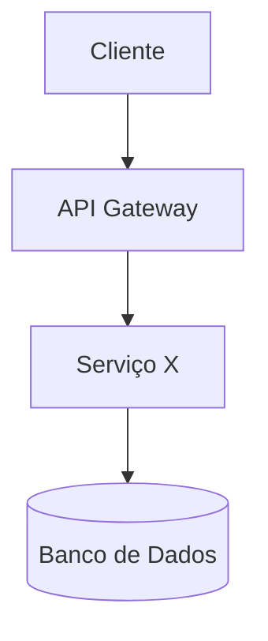

# PR, PRD, SDD, IA no SDLC e Vibe Coding: Guia Completo para Engenharia Moderna

> **Tech Lead / Engenharia · Junho 2026** | Pesquisa aprofundada com fontes verificáveis e rastreáveis

***

## Resumo Executivo

- **PR (Pull Request)** é a unidade atômica de revisão de código em fluxos baseados em branches; no Google o equivalente é o *Changelist* (CL). A revisão de código é o principal mecanismo de controle de qualidade, transferência de conhecimento e rastreabilidade em times modernos.[^1][^2]
- **PRD (Product Requirements Document)** define *o quê* será construído e *por quê*. Alinha PMs, designers, engenheiros e stakeholders antes de qualquer linha de código.[^3][^4]
- **SDD (Software Design Document)** transforma os requisitos do PRD em decisões técnicas: arquitetura, trade-offs, APIs, modelos de dados, segurança e plano de rollout.[^5][^6]
- A relação é sequencial: **Ideia → PRD → SDD → Issues → Implementação → PR → Deploy → Observabilidade**.
- O **DORA Report 2025** pesquisou ~5.000 profissionais e revelou que **90% dos desenvolvedores usam IA diariamente** (+14% vs. 2024), dedicando uma mediana de **2 horas/dia** a ferramentas de IA.[^7]
- O mesmo relatório mostra que IA **amplifica** pontos fortes *e* fraquezas existentes: *"Times com processos frágeis entregam trabalho de baixa qualidade, apenas mais rápido"*.[^8][^9]
- O relatório **Veracode 2025 GenAI Code Security** testou mais de 100 LLMs e encontrou que **45% do código gerado por IA falhou em testes de segurança**, introduzindo vulnerabilidades do OWASP Top 10.[^10]
- **Vibe coding** foi cunhado por Andrej Karpathy em fevereiro de 2025 e eleito pela Collins Dictionary como palavra do ano. Descreve o desenvolvimento orientado por intenção em linguagem natural, onde o código gerado é validado por observação de resultados, não por leitura linha a linha.[^11][^12]
- O preprint **arXiv:2509.12491** (Microsoft Research + U. Victoria, set/2025) é a primeira investigação qualitativa sistemática de vibe coding, baseada em mais de 190.000 palavras de entrevistas e posts. É um *preprint*, não revisado por pares em periódico.[^13]
- O survey **arXiv:2510.12399** (14 autores, Academia Sinica + Duke + UCSD, out/2025) analisa mais de 1.000 papers sobre vibe coding e conclui que seu sucesso depende de **engenharia de contexto sistemática**, ambientes de desenvolvimento configurados e modelos colaborativos humano-agente.[^14]
- **Google**, **Microsoft/GitHub**, **Anthropic** e **OpenAI** convergem na mesma prática: coding agents precisam de **AGENTS.md / CLAUDE.md** com instrução, contexto de repositório e critérios de conclusão.[^15][^16][^17][^18]
- Vibe coding sem governança é **perigoso em produção**: sistemas críticos, segurança, pagamentos, infraestrutura e dados sensíveis exigem PRD, SDD, testes, revisão humana e checklist de segurança.
- O papel do engenheiro humano evolui de *escritor de código* para **arquiteto de contexto, avaliador de outputs e responsável pelo ownership em produção**.[^8][^7]

***

## Glossário

| Termo | Definição |
|-------|-----------|
| **PR (Pull Request)** | Proposta de merge de um branch de feature para o branch principal, incluindo diff de código, descrição, testes e revisão |
| **PRD** | Product Requirements Document — documenta o problema, objetivo, usuários, requisitos funcionais/não-funcionais e métricas de sucesso |
| **SDD** | Software Design Document — transforma requisitos em arquitetura, APIs, modelos de dados, decisões técnicas e plano de rollout |
| **SDLC** | Software Development Life Cycle — ciclo completo de descoberta → design → desenvolvimento → testes → deploy → operação |
| **CI/CD** | Continuous Integration/Continuous Delivery — automação de build, testes e deploy a cada commit |
| **Coding agent** | Sistema de IA autônomo capaz de ler código, escrever código, executar testes, criar PRs e iterar baseado em feedback |
| **Vibe coding** | Paradigma onde o desenvolvedor descreve intenções em linguagem natural e valida o código gerado por observação de resultados, não por leitura linha a linha |
| **Agent mode** | Modo de IDE onde o assistente de IA age autonomamente em múltiplas etapas, editando vários arquivos, rodando comandos e iterando |
| **Context window** | Limite de tokens que um LLM pode processar em uma única sessão; determina quanta informação o agente pode "ver" simultaneamente |
| **MCP (Model Context Protocol)** | Padrão aberto criado pela Anthropic (nov/2024) para conectar assistentes de IA a fontes de dados e ferramentas externas[^19] |
| **RAG** | Retrieval-Augmented Generation — técnica que injeta contexto externo (documentos, banco de dados) nos prompts para reduzir alucinações |
| **Code review** | Processo de inspeção de código por outro desenvolvedor (ou IA) antes do merge, com foco em design, funcionalidade, complexidade, testes, nomenclatura, estilo e segurança[^2] |
| **Trunk-based development** | Estratégia onde todos os desenvolvedores integram mudanças diretamente no branch principal (*trunk*), usando branches de vida curta (< 1 dia)[^20][^21] |

***

## Tabela Comparativa: PR vs. PRD vs. SDD

| Dimensão | PR (Pull Request) | PRD (Product Requirements Doc) | SDD (Software Design Doc) |
|----------|-------------------|-------------------------------|---------------------------|
| **O que é** | Proposta de alteração de código para revisão e merge | Documento que define o quê construir e por quê | Documento que define como construir tecnicamente |
| **Objetivo** | Garantir qualidade, rastreabilidade e segurança antes do merge | Alinhar stakeholders em torno de um problema e solução | Traduzir requisitos em decisões de arquitetura |
| **Público principal** | Desenvolvedores revisores, CI/CD, automações | PMs, designers, engenheiros, stakeholders de negócio | Engenheiros, tech leads, arquitetos |
| **Momento de uso** | Antes de qualquer merge ao branch principal | Antes do início do desenvolvimento | Após PRD aprovado, antes da implementação |
| **Conteúdo principal** | Diff de código, descrição, checklist, testes, contexto da mudança | Problema, objetivo, usuários, hipóteses, requisitos, métricas, riscos, escopo | Contexto, design proposto, APIs, modelos de dados, segurança, trade-offs, alternativas consideradas, plano de rollout |
| **Responsável** | Autor do código; revisores humanos e/ou IA | Product Manager com input de engenharia e design | Tech Lead / Engenheiro Sênior |
| **Relação com IA** | IA revisa, sugere fixes, detecta bugs, integra com coding agents | IA ajuda a redigir, decompor, validar e revisar o PRD | IA gera esboço de SDD a partir do PRD, aponta riscos arquiteturais |
| **Riscos sem o artefato** | Bugs em produção, regressões, vulnerabilidades não detectadas | Retrabalho, features inúteis, falta de alinhamento | Dívida técnica, arquitetura inconsistente, bugs sistêmicos |
| **Tamanho ideal** | Pequeno (< 400 linhas[^22]); focado em uma mudança atômica | 1–3 páginas para features, até 6 para produtos complexos | 2–10 páginas; mais longo para sistemas distribuídos |

***

## Mapa do Fluxo Ideal

```
┌─────────────────────────────────────────────────────────────────────────────┐
│  FLUXO DE ENGENHARIA MODERNO COM IA                                         │
│                                                                             │
│  1. IDEIA / DESCOBERTA                                                      │
│     └─ Pesquisa de usuário, análise de dados, hipóteses                     │
│        IA: análise de feedback, síntese de entrevistas                      │
│                                                                             │
│  2. PRD  ───────────────────────────────────────────────────                │
│     └─ PM escreve; IA ajuda a redigir, revisar e validar                    │
│        Saída: problema claro, requisitos, métricas, critérios aceite        │
│                                                                             │
│  3. SDD  ───────────────────────────────────────────────────                │
│     └─ Engenheiro sênior escreve; IA gera esboço, aponta gaps               │
│        Saída: arquitetura, APIs, modelos de dados, riscos, rollout          │
│                                                                             │
│  4. DECOMPOSIÇÃO EM ISSUES / TASKS                                          │
│     └─ IA decompõe SDD em tarefas técnicas atômicas                        │
│        Saída: issues no GitHub/JIRA com critérios de conclusão              │
│                                                                             │
│  5. IMPLEMENTAÇÃO COM IA                                                    │
│     ├─ Coding agent (Claude Code, Codex, Copilot agent)                     │
│     ├─ Guiado por CLAUDE.md / AGENTS.md / copilot-instructions.md          │
│     └─ Loop: explorar → planejar → implementar → testar → commitar         │
│                                                                             │
│  6. TESTES                                                                  │
│     └─ Unitários, integração, e2e; TDD quando aplicável                     │
│        CI roda automaticamente no PR                                        │
│                                                                             │
│  7. PR (PULL REQUEST)                                                       │
│     ├─ Revisão por IA (Copilot CCR, Gemini CLI Actions, Codex Review)       │
│     ├─ Revisão humana obrigatória para sistemas críticos                    │
│     └─ Checklist de segurança, aprovação, merge                             │
│                                                                             │
│  8. DEPLOY                                                                  │
│     └─ Pipeline CI/CD; feature flags; rollout progressivo                   │
│                                                                             │
│  9. OBSERVABILIDADE                                                         │
│     └─ Logs estruturados, traces, métricas; alertas                         │
│        Charity Majors: o desenvolvedor deve "own" o comportamento           │
│        do código em produção                                      │
│                                                                             │
│ 10. APRENDIZADO / FEEDBACK LOOP                                             │
│     └─ Atualizar CLAUDE.md/AGENTS.md com lições aprendidas                 │
│        Alimentar próximo ciclo de PRD com dados de produção                 │
└─────────────────────────────────────────────────────────────────────────────┘
```

***

## Parte I: Pull Request (PR)

### O que é e para que serve

Um Pull Request é uma proposta formal de integração de um conjunto de mudanças de código de um branch de feature para o branch principal (main/trunk). No ecossistema Google, o equivalente é o **Changelist (CL)** — definido como "um conjunto autocontido de mudanças relacionadas submetidas ao controle de versão".[^23][^2]

O PR serve como:
- **Mecanismo de revisão de código**: outro desenvolvedor (ou IA) examina o código antes do merge[^2]
- **Gate de qualidade**: CI/CD, testes automatizados e análise estática são executados automaticamente
- **Rastreabilidade**: cada mudança fica associada a um issue/task e a uma descrição de contexto
- **Transferência de conhecimento**: revisores aprendem sobre partes do código que não escreveram[^1]

### Boas Práticas de PR (Google Engineering Practices)

O Google Engineering Practices é uma das fontes institucionais mais citadas sobre code review. Seus princípios fundamentais:[^1]

**Para o autor do PR:**
- Mantenha o PR pequeno e focado (atomic commit)[^22]
- Escreva uma descrição clara: o quê mudou e *por quê*, não apenas *como*
- Inclua testes junto com o código no mesmo PR[^1]
- Não espere que o PR seja perfeito — espere que ele melhore o sistema[^1]

**Para o revisor:**
- Responda em no máximo **1 dia útil** (padrão Google)[^23]
- Foque em: design, funcionalidade, complexidade, testes, nomenclatura, comentários, estilo e documentação[^2]
- Use o prefixo **"Nit:"** para comentários cosméticos opcionais[^1]
- Fatos técnicos superam preferências pessoais; o style guide é a autoridade em questões de estilo[^1]
- Favoreça aprovar o PR quando ele *definitivamente melhora* o código, mesmo que não seja perfeito[^1]

**O padrão do Google:** *"Não existe código perfeito — existe código melhor. O objetivo é melhoria contínua, não perfeição."*[^1]

### Estratégias de Branching: PR Tradicional vs. Trunk-Based vs. Ship/Show/Ask

**Martin Fowler** (autor do livro *Refactoring*, Thoughtworks) mantém no seu site um catálogo de padrões de branching. Seu artigo **"Patterns for Managing Source Code Branches"** (mai/2020) é uma referência acadêmica amplamente citada.[^24]

**Ship / Show / Ask** é uma estratégia de branching criada por Rouan Wilsenach e publicada no site de Martin Fowler:[^25][^26]
- **Ship**: vai direto para a mainline, sem review (baixo risco, alta confiança)
- **Show**: abre um PR mas mergeia imediatamente (para visibilidade, não para bloqueio)
- **Ask**: abre um PR para discussão antes do merge (mudanças significativas ou arriscadas)

**Trunk-Based Development (TBD):** Todos integram mudanças diretamente no trunk, com branches de vida máxima de 1 dia. Dave Farley, co-autor do livro *Continuous Delivery* (com Jez Humble, 2010), é um dos maiores defensores do TBD: *"CI significa pouco ou nenhum branching. Em vez disso, fazemos mudanças pequenas no trunk e as avaliamos continuamente."*[^20][^21]

**Evidência empírica:** Um estudo brasileiro publicado no SBES (2025, baseado em entrevistas + survey com desenvolvedores) e outro publicado no arXiv (jul/2025) indicam que trunk-based development favorece **projetos de ritmo acelerado com equipes experientes e pequenas**, enquanto branch-based (GitFlow) é preferido em equipes maiores ou com ciclos de release mais longos. A escolha depende do contexto.[^27][^28]

**Comparação:**

| Estratégia | Velocidade | Risco | Melhor para | Referência |
|------------|-----------|-------|------------|-----------|
| PR tradicional | Média | Baixo | Times médios/grandes, sistemas críticos | Google Eng. Practices[^1] |
| Trunk-based | Alta | Médio-alto | Times experientes, CD, microserviços | Fowler[^20], Farley[^21] |
| Ship/Show/Ask | Alta | Médio | Times com alto nível de confiança mútua | Fowler[^25] |
| PR com coding agent | Alta | Variável | Quando o agente cria e o humano aprova | GitHub[^15][^29] |

### Revisão de PR por IA

**GitHub Copilot Code Review (CCR)** ficou geralmente disponível em abril/2025. Funcionalidades:[^30]
- Detecta bugs, problemas de performance e sugere fixes automáticos
- Integra CodeQL (análise semântica) e ESLint (regras determinísticas) — *"fusão de inteligência LLM e precisão determinística"*[^31]
- Permite handoff: ao mencionar `@copilot` no PR, o CCR aplica os fixes sugeridos em um PR empilhado[^31]
- Suporta VS Code, Visual Studio, JetBrains, Xcode e github.com[^31]

**Gemini CLI GitHub Actions** (Gemini Code Assist, lançado beta ago/2025):[^32]
- Age como agente autônomo para triagem de issues e revisão de PRs
- Acionado por eventos (novo issue, novo PR)
- MCP server para revisão de código está sendo integrado ao workflow padrão[^33]

**OpenAI Codex Review:**
- OpenAI usa Codex para revisar **100% dos PRs internamente**[^34]
- Pode ser ativado automaticamente ou via `@Codex` no PR[^34]

**Limitações da revisão por IA:**
- Alta taxa de falsos positivos em code review automatizado; métricas de F1 em estudos empíricos ficam na faixa de 40–62%[^35]
- IA não substitui revisão humana para decisões de design e contexto de negócio
- Revisão por IA pode ser superficial em código complexo ou com estados implícitos

***

## Parte II: PRD — Product Requirements Document

### O que é e para que serve

Um PRD define **o quê** será construído e **por quê**, ajudando a equipe de desenvolvimento a entender o propósito e a funcionalidade do produto. O Atlassian descreve o PRD como o documento que "detalha o comportamento, propósito e funcionalidades do produto para alinhar stakeholders durante o desenvolvimento".[^4][^3]

### Estrutura Recomendada

| Seção | Conteúdo |
|-------|----------|
| Problema | Qual dor do usuário ou oportunidade de negócio motivou isso? |
| Objetivo | O que o produto ou feature deve atingir? |
| Usuários alvo | Quem usará? Quais seus contextos e jornadas? |
| Hipóteses | Que suposições estamos testando? |
| Requisitos funcionais | O que o sistema *deve fazer* |
| Requisitos não-funcionais | Performance, segurança, acessibilidade, escalabilidade |
| Métricas de sucesso | Como mediremos se deu certo? |
| Fora de escopo | O que explicitamente *não* fazemos nesta iteração |
| Riscos e dependências | O que pode dar errado? Quais sistemas externos dependemos? |
| Critérios de aceitação | Como saberemos que está pronto? |

### PRD para Produtos com IA/LLMs

Produtos baseados em LLMs quebram a premissa de determinismo dos PRDs clássicos: *"Dado o mesmo input, o sistema se comporta da mesma forma"*. LLMs produzem outputs variáveis, custos variáveis e modos de falha sutis.[^36]

Um **PRD para feature com LLM** deve incluir adicionalmente:[^37][^36]
- **Intent scope**: lista de intenções suportadas; intenções *fora de escopo* explicitamente documentadas com fallback
- **Data boundary**: quais dados podem entrar nos prompts e o que deve ser redatado/bloqueado
- **Evidence requirements**: se respostas precisam de citações, links de fonte ou outputs estruturados
- **Cost e latency budgets**: teto de custo por request e SLO de latência
- **Automation level**: somente leitura, rascunho, ou pode acionar ferramentas/ações?
- **Quality plan up front**: suite de testes offline, rubrica de avaliação, suite de regressão de prompt, métricas online
- **Telemetria mínima**: versão de prompt, rota de modelo, fontes de retrieval, resultados de ferramentas

**Como IA ajuda a escrever PRDs:**
- Redigir rascunho inicial a partir de notas de discovery ou transcrições de entrevistas
- Identificar seções faltantes ou ambíguas
- Decompor PRD em tasks técnicas para o SDD
- Validar se os critérios de aceitação são mensuráveis

**Limitação importante:** IA geradora de PRDs tende a produzir documentos longos com linguagem corporativa vaga. O valor do PRD está na síntese e na tomada de decisão humana, não na quantidade de texto.[^38]

***

## Parte III: SDD — Software Design Document

### O que é e sua relação com o PRD

Um SDD (também chamado de *design doc* ou *tech spec*) traduz os requisitos do PRD em decisões técnicas concretas. É o documento que responde: *"Dado que sabemos o quê construir (PRD), como vamos construir tecnicamente?"*[^39]

A diferença essencial:

| Dimensão | PRD | SDD |
|----------|-----|-----|
| Foco | Problema e requisitos de produto | Solução técnica e trade-offs |
| Autor típico | Product Manager | Tech Lead / Engenheiro Sênior |
| Audiência | Todos os stakeholders | Equipe de engenharia |
| Pergunta central | "O quê e por quê?" | "Como e com que trade-offs?" |
| Quando escrever | Antes de qualquer design técnico | Após PRD aprovado |

### Design Docs no Google

O Google é reconhecido por usar design docs como mecanismo padrão antes de implementar features relevantes. Segundo fontes que documentam a prática:[^6][^5]

- Design docs de 10–20 páginas para projetos maiores; mais curtos para features isoladas[^6]
- Foco em *por que* determinada decisão, não apenas *como*[^6]
- Ênfase em **trade-offs considerados** e **alternativas rejeitadas**[^6]
- Revisados com o time mais amplo para construir consenso e identificar preocupações de segurança/privacidade
- Staff Engineers passam mais tempo em docs do que em IDEs para projetos estratégicos[^5]

Como descrito: *"Design docs são uma ótima forma de ganhar clareza e construir consenso em torno dos problemas mais difíceis de um projeto de software."*[^6]

### Estrutura Recomendada de SDD

Baseada em IEEE 1016-2009 (IEEE Recommended Practice for Software Design Descriptions) e práticas do Google:[^40][^41]

```
1. Contexto e Motivação
   - Problema técnico a resolver
   - Relação com o PRD

2. Objetivos e Não-Objetivos Técnicos
   - O que este SDD cobre
   - O que está fora de escopo (deliberadamente)

3. Design Proposto
   - Arquitetura de alto nível (diagrama Mermaid/C4)
   - Componentes e suas responsabilidades
   - Fluxo de dados e controle
   - Stack tecnológica e justificativa

4. APIs e Contratos
   - Endpoints, schemas, contratos de interface
   - Tratamento de erros e casos de borda

5. Modelo de Dados
   - Entidades, relacionamentos, estratégia de migração

6. Segurança
   - Autenticação, autorização, proteção de dados
   - Vetores de ataque considerados

7. Observabilidade
   - Logs estruturados, traces, métricas, alertas
   - Como saberemos se algo está errado em produção?

8. Escalabilidade e Performance
   - SLOs esperados
   - Limites e gargalos conhecidos

9. Trade-offs e Alternativas Consideradas
   - Opções rejeitadas e motivo
   - Dívida técnica aceita conscientemente

10. Plano de Rollout
    - Feature flags, rollout progressivo, rollback plan

11. Testes
    - Estratégia de teste: unitário, integração, e2e
    - Critérios de cobertura mínima
```

### SDD para Sistemas com IA

Sistemas baseados em IA exigem seções adicionais no SDD:
- Estratégia de RAG (se aplicável): fontes de dados, chunking, vetorização, retrieval
- Gestão de prompts: versionamento, testes de regressão de prompt
- Fallbacks e degradação graciosa quando o LLM falha ou retorna conteúdo indesejado
- Custo projetado por request e por mês
- Política de logging (incluindo quais inputs/outputs registrar para auditoria)
- Avaliação de saídas: rubrica, dataset de golden answers

***

## Parte IV: IA no Ciclo de Desenvolvimento

### Mapa de Aplicação por Etapa do SDLC

| Etapa | Aplicação de IA | Ferramentas Relevantes | Limitações |
|-------|----------------|----------------------|-----------|
| Descoberta | Síntese de entrevistas, análise de feedback, pesquisa de mercado | ChatGPT, Claude, Gemini | Alucinação, falta de contexto de negócio específico |
| PRD | Rascunho, validação, decomposição em tasks | Claude, GPT-4o, Copilot Chat | Texto vago, falta de decisão humana estratégica |
| SDD | Esboço de arquitetura, revisão de trade-offs, detecção de riscos | Claude, Gemini, GPT-4o | Pode sugerir padrões inadequados para o contexto |
| Decomposição de tasks | PRD → Issues → subtasks técnicas | Codex, Claude Code, Copilot | Decomposição superficial sem contexto de codebase |
| Geração de código | Autocomplete, chat, agent mode, coding agent | Copilot, Claude Code, Codex, Gemini CA | Bugs sutis, vulnerabilidades OWASP, package hallucinations |
| Testes | Geração de testes unitários, mocks, casos de borda | Copilot, Claude Code | Cobertura de caminho, não cobertura de comportamento real |
| Revisão de PR | Detecção de bugs, sugestões de fix, análise de segurança | Copilot CCR, Gemini CLI, Codex Review | Falsos positivos, revisão superficial, contexto limitado |
| Documentação | Geração de docstrings, READMEs, changelogs | Copilot, Claude, Gemini | Docs genéricos, desatualizados sem manutenção |
| Segurança | SAST assistido por IA, detecção de vulnerabilidades | Copilot (CodeQL), Semgrep, Veracode | 45% de código IA com vulnerabilidades[^10] |
| Refatoração | Sugestões de simplificação, migração de padrões | Claude Code, Codex | Pode introduzir regressões sutis |
| Debugging | Análise de erros, sugestão de fixes | Claude Code (explore → plan → fix) | Pode corrigir sintoma em vez de causa raiz[^16] |
| Deploy / Observabilidade | Análise de logs, triagem de alertas | Gemini CLI Actions, Codex Automations | Contexto limitado de produção |

### Tipos de Assistência de IA: Hierarquia

```
┌─────────────────────────────────────────────────────────────┐
│ NÍVEL DE AUTONOMIA DOS ASSISTENTES DE IA EM CÓDIGO          │
│                                                              │
│ ALTO ┌─────────────────────────────────────────────────┐    │
│      │  Coding Agent Cloud (Codex cloud, Copilot agent)│    │
│      │  Trabalha em background, cria PRs autonomamente │    │
│      ├─────────────────────────────────────────────────┤    │
│      │  Coding Agent Local (Claude Code, Codex CLI)    │    │
│      │  Loop autônomo no terminal; edita + roda testes │    │
│      ├─────────────────────────────────────────────────┤    │
│      │  Agent Mode no IDE (Copilot, Gemini CA agent)   │    │
│      │  Multi-step, multi-file, com aprovação humana   │    │
│      ├─────────────────────────────────────────────────┤    │
│      │  Chat no IDE (Copilot Chat, Gemini Chat)        │    │
│      │  Pergunta/resposta + geração de blocos de código│    │
│      ├─────────────────────────────────────────────────┤    │
│ BAIXO│  Autocomplete inline (Copilot, Tabnine)         │    │
│      │  Sugestão linha a linha enquanto você digita    │    │
│      └─────────────────────────────────────────────────┘    │
└─────────────────────────────────────────────────────────────┘
```

### Riscos e Limitações da IA no Desenvolvimento

**Técnicos:**
- **Alucinação de packages**: pesquisa com 576.000 amostras de código encontrou 440.445 referências a packages que não existem. GPT: 5,2% de hallucination; modelos open-source: 21,7%. O ataque chamado *"slopsquatting"* explora esse vetor.[^42][^43]
- **Vulnerabilidades de segurança**: Veracode 2025 testou 100+ LLMs; 45% do código gerou falhas de segurança; Java teve 72% de failure rate. Desempenho de segurança permanece **plano** independentemente do tamanho ou sofisticação do modelo.[^10]
- **Bugs sutis**: benchmarks como HumanEval e MBPP sugerem 80–90% de sucesso dos LLMs, mas em codebases de produção reais as taxas de sucesso caem dramaticamente.[^44]
- **Dívida técnica acelerada**: DORA 2025 mostra que maior adoção de IA correlaciona com maior *instabilidade*.[^9][^8]

**Organizacionais:**
- **Dependência excessiva**: OWASP LLM09:2025 (*Misinformation/Overreliance*) documenta que usuários que confiam excessivamente em outputs de LLM sem verificação tomam decisões baseadas em informações incorretas.[^45]
- **Perda de conhecimento técnico**: código que nenhum engenheiro leu ou entende torna-se um *"código legado instantâneo"*; sem ownership humano, debugging em produção se torna muito difícil.
- **Revisão superficial**: quando 100% do código é gerado por IA, revisores humanos tendem a revisar menos rigorosamente — um achado do estudo qualitativo da Microsoft Research sobre vibe coding.[^46]

***

## Parte V: Como Google, Microsoft/GitHub, Anthropic e OpenAI Orientam o Uso de IA

### Google

**Pilar 1: Google Engineering Practices — Code Review**
O Google Engineering Practices é documentação pública e canônica das políticas de code review do Google. Princípios:[^2]
- O objetivo primário da revisão de código é **melhorar a saúde geral do codebase ao longo do tempo**[^1]
- Fatos técnicos superam preferências pessoais[^1]
- Conflitos devem ser resolvidos com dados; se necessário, escalados (não deixados pendentes)[^1]

**Pilar 2: Design Docs**
Prática cultural descrita em *Software Engineering at Google* (Titus Winters, Tom Manshreck, Hyrum Wright; O'Reilly, 2020): antes de projetos relevantes, engenheiros escrevem design docs para resolver problemas cedo, documentar decisões e construir consenso.[^47][^6]

**Pilar 3: Gemini Code Assist**
- **Agent Mode** disponível para todos (VS Code e IntelliJ) em ago/2025: descreva o objetivo → Gemini propõe plano → você aprova → executa[^32]
- Suporta MCP, integração com ferramentas do ecossistema, *Human in the Loop (HiTL)*[^32]
- **Gemini CLI GitHub Actions** (beta, ago/2025): agente autônomo para triagem de issues e revisão de PRs, acionado por eventos de repositório[^32]
- Context window de **1M de tokens** com Gemini 3[^48]

**Pilar 4: DORA 2025**
Pesquisa com ~5.000 profissionais:[^7]
- 90% dos desenvolvedores usam IA diariamente (+14% vs. 2024)
- Mediana de 2h/dia de uso de IA
- 80%+ reportam ganhos de produtividade
- 59% reportam melhora na qualidade do código
- Mas: AI adoption correlaciona com maior instabilidade; a chave é *reconstruir sistemas e processos* para que a IA opere com segurança[^8]
- Introduziu o **DORA AI Capabilities Model**: 7 capacidades técnicas e culturais para amplificar o impacto positivo da IA[^49]

### Microsoft / GitHub

**GitHub Copilot** evoluiu de autocomplete (2021) para um sistema multi-modal:[^50]

**Copilot Code Review (CCR) — GA desde abril/2025:**[^30]
- Analisa PRs e oferece fixes automáticos
- Integra detecções LLM + ferramentas determinísticas (CodeQL, ESLint)[^31]
- Configurável via `copilot-instructions.md` para adaptar tom e prioridades[^31]
- Disponível em todos os planos Copilot pagos; automação configurável por repositório ou organização[^51]

**Copilot Coding Agent:**[^29]
- Agente autônomo em background: dado um issue ou task, pesquisa o repositório, cria plano, faz mudanças em branch, abre PR
- Suporta **AGENTS.md** para instruções customizadas por projeto[^15]
- Também suporta `CLAUDE.md` e `GEMINI.md` (interoperabilidade intencional)[^15]

**Copilot Agent Mode no IDE:** (VS Code, lançado fev/2025)[^52]
- *"Programador par autônomo"*: executa tarefas multi-step autonomamente
- Edita múltiplos arquivos, roda comandos, itera baseado em erros

**Microsoft Learn:** Módulo oficial *"Developer use cases for AI with GitHub Copilot"* documenta como o Copilot se integra ao SDLC, alinha com preferências de desenvolvedores e mede ganhos de produtividade.[^53]

### Anthropic

**Claude Code** é o coding agent CLI da Anthropic, com documentação de best practices pública em anthropic.com/engineering.[^16]

**Princípios-chave do Claude Code:**[^16]

1. **Contexto é o recurso fundamental**: a context window se preenche rápido; performance degrada quando cheia. Gerencie contexto agressivamente com `/clear`, `/compact` e subagentes.

2. **Explore → Planeje → Implemente → Commit**: nunca deixe o agente ir direto para código em tarefas complexas. Use *plan mode* (`Ctrl+G`) para separar exploração de execução.

3. **CLAUDE.md**: arquivo lido em toda sessão. Deve conter: comandos Bash, regras de estilo, workflow específico do projeto. Deve ser curto e preciso — *"se remover não causaria erro, remova"*.[^16]

4. **Verificação autônoma**: sempre forneça ao agente um *check* que ele possa rodar (suite de testes, build, screenshot). A diferença entre uma sessão que você assiste e uma que você delega completamente.

5. **Subagentes**: delegue investigação a subagentes para não poluir o contexto principal. Padrão Writer/Reviewer: sessão A implementa, sessão B revisa em contexto limpo.

6. **MCP (Model Context Protocol)**: padrão aberto (nov/2024) para conectar Claude a fontes externas (GitHub, banco de dados, Notion, Figma). Configurado via `claude mcp add`.[^19]

7. **Segurança de contexto (CVE-2025-55284)**: uma vulnerabilidade no Claude Code permitia exfiltração de dados via requisições DNS. Anthropic documentou e corrigiu. Mostra que mesmo as ferramentas de IA têm vetores de ataque.[^54]

**Boas práticas de prompt para Claude Code:**[^55][^16]
- `"think"` ativa modo de pensamento estendido
- `"think hard"` > `"think"`, `"think harder"` > `"think hard"`, `"ultrathink"` = budget máximo[^55]
- Para tarefas complexas: *"Interview me using AskUserQuestion tool before writing any code"*

### OpenAI

**Codex** é o coding agent da OpenAI, geralmente disponível desde out/2025. Alimentado pelo modelo `GPT-5-Codex`.[^56]

**Modalidades de uso:**[^57][^58]
- **Codex cloud (web)**: agente em background, integrado ao GitHub, cria PRs autonomamente; suporta múltiplas tasks em paralelo
- **Codex CLI**: agente open-source local no terminal; powered by `o4-mini` otimizado para engenharia de software[^59]
- **Codex SDK** (out/2025): integre o mesmo agente em workflows e apps próprios[^56]
- **Integração Slack**: `@Codex` em canais/threads para delegar tasks[^56]
- **GitHub Action**: integração em pipelines CI/CD[^56]

**AGENTS.md** é o arquivo de instrução do Codex:[^17][^18]
- Lido antes de qualquer trabalho
- Estrutura hierárquica: global (`~/.codex/AGENTS.md`) → projeto (raiz do repositório) → subdiretórios
- Deve conter: layout do repositório, como rodar o projeto, comandos de build/test/lint, convenções de PR, constraints ("nunca rotacione API keys sem notificar o canal de segurança")[^18]
- `AGENTS.override.md` tem precedência para overrides temporários

**Segurança do Codex:**[^17]
- Opera em container isolado, sem acesso à internet durante execução
- Treinado para recusar desenvolvimento de malware
- Usuários *devem revisar e validar todo código gerado* antes de integração e execução — nota explícita da OpenAI[^17]
- Modo Zero Data Retention disponível para Enterprise[^60]

**OpenAI usa Codex internamente para revisar 100% dos PRs**.[^34]

### Convergências e Divergências entre as Empresas

**Convergências (consenso entre Google, GitHub, Anthropic, OpenAI):**
- Arquivos de instrução por repositório (AGENTS.md / CLAUDE.md / copilot-instructions.md) são padrão
- Revisão humana continua obrigatória para código gerado por IA antes do merge em produção
- Testes automatizados são critério de conclusão para agentes
- Agentes são mais eficazes com contexto rico e verificação autônoma

**Divergências:**
- **Modelo de permissão**: Codex opera em ambiente air-gapped por padrão; Claude Code usa sandboxing configurável; Copilot agent tem mais integração com o ambiente local[^16][^17]
- **Ênfase em contexto**: Anthropic é a mais explícita sobre gestão de context window; OpenAI enfatiza plano e estrutura de prompt[^34][^16]
- **Integração de review**: GitHub/Copilot integra CodeQL (análise estática determinística) com LLM; Anthropic usa subagentes para revisão adversarial[^16][^31]

***

## Parte VI: Vibe Coding

### Definição e Origem (Fontes Rastreáveis)

O termo foi cunhado por **Andrej Karpathy** — co-fundador da OpenAI, ex-diretor de IA da Tesla — em uma postagem no X (antigo Twitter) em **2 de fevereiro de 2025**:[^61][^11]

> *"There's a new kind of coding I call 'vibe coding', where you fully give in to the vibes, embrace exponentials, and forget that the code even exists. [...] It's not really coding anymore — I just see stuff, say stuff, run stuff, and copy stuff."*

Karpathy foi explícito de que descrevia o que era *possível*, não o que era recomendável para software de produção. A Collins Dictionary nomeou "vibe coding" como a **palavra do ano 2025**.[^62][^12]

**O fluxo do vibe coding:**
1. Descreva o que quer em linguagem natural
2. A IA escreve o código
3. Você roda o código
4. Se funciona, avança; se quebra, cola o erro de volta para a IA
5. Você nunca lê o código linha a linha
6. Você permanece no nível de intenção, não de implementação

### Diferenciação de Paradigmas

| Paradigma | Quem escreve o código | Supervisão humana | Adequado para produção |
|-----------|----------------------|-------------------|----------------------|
| Desenvolvimento tradicional | Humano | Alta | Sim |
| Pair programming com IA | IA + Humano (co-autoria) | Alta | Sim (com revisão) |
| Agent mode / Eng. assistida | IA autônoma, guiada por spec | Média | Sim (com PRD+SDD+testes+PR) |
| Vibe coding puro | IA autônoma sem spec | Baixa | **Não para sistemas críticos** |

### Literatura Acadêmica sobre Vibe Coding

**⚠️ Nota metodológica**: a maioria dos estudos sobre vibe coding ainda está em fase de *preprint* (não revisados por pares em periódico) por ser um fenômeno muito recente (desde fev/2025). Trate os achados como evidência emergente, não consenso estabelecido.

**1. "Good Vibrations?" — arXiv:2509.12491 (set/2025)**
- **Tipo**: Preprint (arXiv); submetido por pesquisadores da Microsoft Research, University of Victoria e University of Washington[^13]
- **Método**: Investigação qualitativa sistemática; análise de mais de 190.000 palavras de entrevistas semiestruturadas, threads do Reddit e posts do LinkedIn[^46][^13]
- **Achados principais**: Vibe coding é centrado em interação conversacional com IA, co-criação e *flow* do desenvolvedor. A confiança no AI regula um continuum entre delegação e co-criação. Pontos de dor recorrentes: especificação, confiabilidade, debugging, latência, carga de code review e colaboração[^46]
- **Limitações**: amostra qualitativa, não generalizável quantitativamente; foco em percepções, não em métricas de output de código
- **O que pode ser generalizado**: identificação de práticas emergentes e pontos de falha recorrentes

**2. "A Survey of Vibe Coding with LLMs" — arXiv:2510.12399 (out/2025, rev. dez/2025)**
- **Tipo**: Survey/preprint; 14 autores de Academia Sinica, Duke, UCSD, Peking, Queensland[^14]
- **Método**: Análise sistemática de mais de 1.000 papers sobre o ecossistema de vibe coding[^63]
- **Achados principais**: Formaliza vibe coding como disciplina via *Constrained Markov Decision Process*. Propõe taxonomia com 5 modelos: *Unconstrained Automation*, *Iterative Conversational Collaboration*, *Planning-Driven*, *Test-Driven* e *Context-Enhanced*. Conclui que sucesso requer *context engineering sistemático*, ambientes configurados e modelos colaborativos[^14]
- **Limitações**: Survey inclui literatura heterogênea; qualidade dos estudos primários varia muito
- **O que pode ser generalizado**: taxonomia e framework conceitual; recomendação de práticas estruturadas

**3. "Vibe Coding: A Multivocal Systematic Mapping Study" — IEEE SNPD 2025 (maio/2025)**
- **Tipo**: Artigo em conferência IEEE (revisado por pares)[^64]
- **Autores**: Nicole Beaulieu, Sergiu Dascalu, Emily Hand (University of Nevada, Reno)
- **Método**: Systematic Mapping Study multivocal
- **Publicado em**: IEEE/ACIS 29th International Conference on Software Engineering, AI, Networking and Parallel/Distributed Computing (SNPD 2025)
- **Achados**: Mapeamento sistemático do campo emergente

**4. "Academic Vibe Coding: Opportunities for Accelerating Research in an Era of Resource Constraint" — 2025**
- **Tipo**: Preprint[^65]
- **Achados**: Vibe coding estruturado com LLMs em workflows reproduzíveis pode comprimir o ciclo ideia-análise e reduzir pressão em times de ciência de dados, mas requer governança e aplicação cuidadosa

### Quando Vibe Coding É Útil vs. Perigoso

**✅ Contextos adequados para vibe coding:**
- Protótipos e provas de conceito
- MVPs para validação de hipóteses
- Automações internas sem dados sensíveis
- Scripts de uso único
- Ferramentas de desenvolvimento pessoal
- Interfaces simples para experimentação
- Projetos educacionais e de aprendizado

**🚫 Contextos onde vibe coding é perigoso sem governança:**
- Sistemas financeiros ou de pagamentos
- Código que processa dados pessoais ou sensíveis (LGPD, GDPR)
- Infraestrutura crítica ou de segurança
- APIs expostas à internet sem validação
- Código de autenticação e autorização
- Compliance e auditoria regulatória
- Qualquer sistema onde um bug silencioso pode causar dano real

**Base para essa avaliação:** Veracode 2025 mostra 45% de vulnerabilidades em código IA; estudos sobre vibe coding identificam debugging, especificação e confiabilidade como pontos de falha sistemáticos; OWASP documenta overreliance como vetor de risco.[^45][^10][^46]

### Como Transformar Vibe Coding em Processo Profissional

O vibe coding não precisa ser abandonado — precisa ser **estruturado**:

```
VIBE CODING PROFISSIONAL = VIBE CODING + GOVERNANÇA

Vibe Coding Puro:          → Profissional:
Nenhuma spec               → PRD leve (1 página)
Nenhum design              → SDD enxuto (decisões chave)
Sem testes                 → Testes unitários para lógica crítica
PR grande ou sem PR        → PRs pequenos e atômicos
Sem revisão                → Revisão por IA + humana
Deploy direto              → Checklist de segurança antes do merge
```

***

## Parte VII: Engenheiros e Autores Reconhecidos

### Martin Fowler

**Quem é:** Autor de *Refactoring* e *Patterns of Enterprise Application Architecture*; Chief Scientist na Thoughtworks. Um dos mais influentes arquitetos de software do mundo.

**Por que relevante:** Mantém um catálogo de práticas em martinfowler.com com artigos técnicos rastreáveis e datas de publicação.

**Práticas defendidas:**
- **Continuous Integration** (artigo mai/2024): CI = trunk-based development com commits frequentes ao trunk; branches de vida curta (< 1 dia)[^20]
- **Branching Patterns** (artigo mai/2020): catálogo de padrões de branching; trunk-based é o padrão recomendado para CI verdadeiro[^24]
- **Ship / Show / Ask** (publicado em seu site, artigo de Rouan Wilsenach, set/2021): estratégia que combina agilidade e revisão seletiva[^25]

**Classificação:** Opinião técnica de praticante experiente + experiência de mercado da Thoughtworks. Não é evidência empírica controlada, mas é amplamente adotada e influente.

### Kent Beck

**Quem é:** Criador do TDD (Test-Driven Development) e do Extreme Programming (XP); co-autor do *Manifesto Ágil*.

**Por que relevante:** TDD é uma das poucas práticas de engenharia com evidência empírica razoável de melhora de design.

**Práticas defendidas:**
- TDD: escrever o teste *antes* do código; ciclo Red → Green → Refactor. *"TDD ajuda a conduzir a um design melhor por forçar a aplicação de Dependency Inversion"*[^21]
- Small steps: commits a cada 10–15 minutos; feedback em menos de 5 minutos[^21]

**Classificação:** Experiência prática + base teórica do XP. TDD tem suporte em estudos empíricos, mas os resultados variam por contexto.

### Dave Farley

**Quem é:** Co-autor de *Continuous Delivery* (com Jez Humble, 2010); fundador do canal YouTube *Modern Software Engineering*; fundador da Continuous Delivery Ltd.[^66]

**Por que relevante:** CD é um dos frameworks mais influentes de entrega de software moderno, com métricas documentadas pelo DORA.

**Práticas defendidas:**
- Continuous Integration: commits ao trunk pelo menos uma vez ao dia; fixar falhas em 10 minutos ou reverter[^21]
- Pipelines de entrega contínua como o principal mecanismo de qualidade
- *"A melhora contínua requer feedback rápido e frequente"*[^21]

**Classificação:** Livro técnico de referência + experiência de mercado + dados DORA. O livro *Continuous Delivery* de Humble/Farley é uma das obras mais citadas em DevOps.

### Charity Majors

**Quem é:** Co-fundadora e CTO da Honeycomb; co-autora de *Observability Engineering*; ex-engenheira de operações e DBA.

**Por que relevante:** Voz líder em observabilidade; defende que desenvolvedores devem "própriamente" o comportamento de seu código em produção.

**Práticas defendidas:**
- Observabilidade como pré-requisito para adicionar código de IA ou usar agentes de IA[^67]
- Desenvolvedores devem fazer deploys pequenos e frequentes para reduzir o escopo do debugging
- *"Não há mais equipes separadas de Dev e Ops — há apenas engenheiros que escrevem código E fazem ownership em produção"*[^67]
- Dashboards estáticos são inadequados; o foco deve ser em exploração de dados de alta cardinalidade

**Classificação:** Opinião técnica de praticante + experiência fundando empresa de observabilidade. Não é pesquisa empírica controlada, mas é influente e coerente com dados DORA.

***

## Parte VIII: Melhores Práticas Consolidadas

### Para PRD

1. Comece com o problema, não com a solução
2. Mantenha curto (1–3 páginas para features); use bullet points, não prosa
3. Defina explicitamente o que está **fora de escopo**
4. Inclua métricas de sucesso *mensuráveis* (não "melhorar a experiência")
5. Para features com IA: adicione seções de intent scope, data boundary, quality plan e telemetria[^36]
6. Use IA para rascunhar, mas o PM decide; revise para remover texto vago[^38]
7. Valide o PRD com engenharia antes de escrever o SDD (checar viabilidade técnica)

### Para SDD

1. Escreva *depois* do PRD aprovado, *antes* da implementação
2. Foque em *por que* determinada decisão, não apenas *como*[^6]
3. Inclua alternativas consideradas e por que foram rejeitadas
4. Documente dívida técnica aceita conscientemente
5. Para sistemas distribuídos: inclua diagramas (C4, Mermaid), fluxo de dados, SLOs
6. Mantenha o SDD atualizado se decisões mudam durante a implementação

### Para PR

1. Mantenha pequeno: idealmente < 400 linhas de mudanças reais[^22]
2. Um PR = uma mudança lógica; não misture refatorações com features
3. Escreva descrição que explique o *porquê*, não apenas o *o quê*
4. Inclua testes no mesmo PR que o código[^1]
5. Responda a revisões em 1 dia útil[^23]
6. Use IA para revisão rápida, mas exija revisão humana para código crítico[^30]
7. Configure AGENTS.md/copilot-instructions para padronizar o que a IA deve verificar

### Para Code Review com IA

1. Configure revisão automática para todos os PRs (via GitHub Rulesets)[^51]
2. Use medium/high effort para código sensível à segurança[^51]
3. Não aceite fixes sugeridos pela IA sem entender o que fazem
4. Trate comentários de IA como sugestões, não como ordens
5. Mantenha revisão humana para mudanças arquiteturais, APIs públicas e código de segurança
6. Codifique as prioridades de revisão em `copilot-instructions.md` / `AGENTS.md`[^31]

### Para Prompts de Coding Agents

Estrutura recomendada (baseada em Anthropic, OpenAI e GitHub):[^34][^16]

```
Goal:       O que você quer mudar ou construir?
Context:    Quais arquivos, pastas, docs ou erros são relevantes?
Constraints: Padrões, arquitetura, segurança, convenções a seguir?
Done when:  O que deve ser verdade quando terminar? (testes passando, bug não reproduzível)
```

Para tarefas complexas: *"Explore o código primeiro sem fazer mudanças. Depois me apresente um plano antes de implementar."*[^16]

### Para Segurança

1. Nunca deploye código gerado por IA sem revisão de segurança
2. Rode análise estática (SAST) em todo PR — SAST + LLM é mais eficaz que qualquer um isolado[^31]
3. Verifique manualmente todos os packages sugeridos pela IA antes de instalar[^43]
4. Para dados sensíveis, LGPD/GDPR: nenhum input/output de usuário real deve entrar em prompts sem política de privacidade clara
5. Configure `AGENTS.md` com regras explícitas: *"Nunca escreva credenciais em código; nunca acesse APIs de produção em testes"*[^18]
6. Use sandboxing em coding agents quando possível[^16]

***

## Parte IX: Checklists Práticos

### ✅ Checklist de PRD

- [ ] O problema está descrito em termos de usuário, não de solução
- [ ] O objetivo é mensurável (inclui número ou critério verificável)
- [ ] Os usuários alvo estão identificados com contexto
- [ ] Os requisitos funcionais estão listados atomicamente
- [ ] Os requisitos não-funcionais incluem performance, segurança e acessibilidade
- [ ] As métricas de sucesso são específicas e mensuráveis
- [ ] O escopo *fora* do PRD está explicitamente listado
- [ ] Riscos e dependências técnicas estão identificados
- [ ] Os critérios de aceitação são verificáveis
- [ ] **Para features com IA:** Intent scope, data boundary, quality plan e telemetria estão definidos[^36]
- [ ] O PRD foi revisado por pelo menos um engenheiro para validar viabilidade técnica
- [ ] O documento tem no máximo 3 páginas para features, 6 para produtos

### ✅ Checklist de SDD

- [ ] O SDD referencia o PRD de origem
- [ ] A motivação técnica está clara (por que agora, por que assim)
- [ ] Os objetivos técnicos e não-objetivos estão explicitados
- [ ] A arquitetura tem diagrama ou descrição textual clara
- [ ] As APIs e contratos de interface estão definidos
- [ ] O modelo de dados (entidades, relacionamentos) está descrito
- [ ] Segurança: autenticação, autorização, proteção de dados estão cobertos
- [ ] Observabilidade: como saberemos se algo quebrou em produção?
- [ ] Escalabilidade e performance: SLOs e limitações conhecidas
- [ ] Alternativas consideradas e motivo da rejeição estão documentadas
- [ ] O plano de rollout inclui feature flags ou rollout progressivo
- [ ] A estratégia de testes está definida

### ✅ Checklist de PR

- [ ] O PR tem menos de 400 linhas de mudanças reais
- [ ] A descrição explica o *porquê* da mudança
- [ ] Há um link para o issue/task relacionado
- [ ] Os testes estão incluídos no mesmo PR
- [ ] A CI passou (build + testes + lint)
- [ ] Não há secrets ou credenciais hardcoded
- [ ] Não há `console.log` / `print` de debug esquecidos
- [ ] A revisão por IA foi solicitada (Copilot CCR, Gemini, Codex)
- [ ] Pelo menos um revisor humano foi designado
- [ ] Para mudanças de segurança: revisor especializado foi designado
- [ ] Documentação foi atualizada se necessário

### ✅ Checklist de Revisão por IA

- [ ] Os fixes sugeridos pela IA foram lidos e compreendidos (não aceitos cegamente)
- [ ] A IA identificou vulnerabilidades de segurança? Elas foram investigadas?
- [ ] A IA identificou problemas de performance? Eles são relevantes no contexto?
- [ ] Os falsos positivos foram descartados com justificativa
- [ ] Mudanças arquiteturais foram revisadas por humano, não apenas por IA
- [ ] As regras de revisão em `copilot-instructions.md` / `AGENTS.md` estão atualizadas

### ✅ Checklist de Vibe Coding Seguro

- [ ] O contexto é de protótipo/MVP/script interno (não produção crítica)
- [ ] Um PRD leve (1 página) foi escrito antes de começar
- [ ] O CLAUDE.md / AGENTS.md está configurado para o projeto
- [ ] Cada sessão tem um critério de "done" claro (teste passando, comportamento esperado)
- [ ] Todo código gerado foi revisado por um humano antes do deploy
- [ ] Não há dados reais de usuários sendo processados sem validação
- [ ] Os packages sugeridos pela IA foram verificados antes de instalação[^43]
- [ ] Há um plano de rollback se o feature causar problemas
- [ ] A sessão de vibe coding resultou em um PR pequeno, não em um commit gigante

### ✅ Checklist de Uso de IA em Produção

- [ ] O código gerado por IA passou por revisão de segurança (SAST + revisão humana)
- [ ] Os testes cobrem os caminhos críticos (não apenas cobertura de linha)
- [ ] Há observabilidade: logs, traces, alertas configurados
- [ ] O feature tem um mecanismo de rollback (feature flag, rollback de deploy)
- [ ] A equipe entende o código (não é "caixa preta" de IA)
- [ ] Dados sensíveis não entram em prompts de IA sem política de privacidade aprovada
- [ ] Há ownership humano claro para bugs em produção
- [ ] O modelo/versão de IA usado está documentado (para reproduzibilidade)

***

## Parte X: Modelos Prontos

### Template de PRD (Produto Digital)

```markdown
# PRD: [Nome da Feature/Produto]

**Versão:** 0.1 | **Status:** Rascunho | **Autor:** [Nome] | **Data:** [Data]
**Stakeholders:** [PM, Tech Lead, Designer, Stakeholder de negócio]

## Problema
[Descreva o problema do usuário em 2–3 frases. Use dados se disponíveis.]

## Objetivo
[Uma frase clara: "Ao final desta iteração, [usuário] poderá [ação] de modo que [resultado mensurável]."]

## Usuários Alvo
- **Persona principal:** [nome/descrição]
- **Contexto de uso:** [onde, quando, como]

## Hipóteses
- Acreditamos que [ação/feature] resultará em [resultado] porque [razão]
- Métricas que validarão/invalidarão essa hipótese: [métrica]

## Requisitos Funcionais
1. [RF-01] O usuário deve conseguir [...]
2. [RF-02] O sistema deve [...]

## Requisitos Não-Funcionais
- Performance: [SLO de latência, throughput]
- Segurança: [autenticação, criptografia, LGPD]
- Acessibilidade: [WCAG nível, screen readers]

## Métricas de Sucesso
- [Métrica 1]: Meta de [valor] em [prazo]
- [Métrica 2]: Meta de [valor] em [prazo]

## Fora de Escopo
- [Funcionalidade X] (será tratada em iteração futura)
- [Funcionalidade Y] (depende de [pré-requisito])

## Riscos e Dependências
- **Risco:** [descrição] | **Mitigação:** [ação]
- **Dependência:** [sistema/time/API]

## Critérios de Aceitação
- [ ] [Critério 1 verificável]
- [ ] [Critério 2 verificável]
```

### Template de PRD (Produto com IA/LLM)

```markdown
# PRD: [Feature com IA]
[Inclui todas as seções do PRD padrão, mais:]

## Intent Scope (IA)
**Intenções suportadas:**
- [Intenção 1: o que o usuário pode pedir]
- [Intenção 2]

**Fora de intent scope (com fallback explícito):**
- [Intenção X] → Fallback: [mensagem de erro ou handoff humano]

## Constraints de IA
- **Data boundary:** [quais dados podem entrar no prompt; o que deve ser redatado]
- **Evidence requirements:** [respostas precisam de citações? structured output?]
- **Cost budget:** [teto de custo por request e mensal]
- **Latency budget:** [P95 máximo aceitável]
- **Automation level:** [somente leitura / rascunho / pode acionar ações]

## Quality Plan
- **Offline evaluation:** [dataset de golden answers, rubrica de avaliação]
- **Prompt regression suite:** [casos que não devem regredir]
- **Online metrics:** [task completion rate, latência, custo, thumbs up/down]

## Telemetria Mínima
- Versão de prompt em uso
- Rota de modelo (qual modelo, qual temperatura)
- Fontes de retrieval (se RAG)
- Resultados de ferramentas chamadas
- Reason codes para erros ou fallbacks
```

### Template de SDD

```markdown
# SDD: [Nome do Sistema/Feature]

**PRD de origem:** [link] | **Status:** Rascunho | **Autor:** [Tech Lead]

## 1. Contexto e Motivação
[Por que esse sistema/feature precisa existir tecnicamente? Como se conecta ao PRD?]

## 2. Objetivos Técnicos e Não-Objetivos
**Objetivos:**
- [O que este SDD cobre]
**Não-objetivos:**
- [O que está deliberadamente fora de escopo]

## 3. Design Proposto
### 3.1 Arquitetura de Alto Nível


### 3.2 Componentes Principais
| Componente | Responsabilidade | Tecnologia |
|-----------|----------------|-----------|
| [Nome] | [O que faz] | [Stack] |

## 4. APIs e Contratos
### POST /api/v1/[recurso]
**Request:**
```json
{ "campo": "tipo" }
```
**Response:** `200 OK` | `400 Bad Request` | `500 Internal Error`

## 5. Modelo de Dados
[Diagrama de entidades ou descrição de schemas]

## 6. Segurança
- Autenticação: [mecanismo]
- Autorização: [políticas de acesso]
- Dados sensíveis: [criptografia, retenção, LGPD]

## 7. Observabilidade
- Logs: [formato, campos obrigatórios]
- Traces: [spans, IDs de correlação]
- Alertas: [condições e thresholds]

## 8. Escalabilidade
- SLO: [P95 de latência, disponibilidade %]
- Gargalos conhecidos: [limites e mitigações]

## 9. Alternativas Consideradas
| Opção | Por que foi rejeitada |
|-------|----------------------|
| [Opção A] | [Motivo] |

## 10. Plano de Rollout
- Feature flag: [nome e condição de ativação]
- % inicial de tráfego: [valor]
- Critério de rollback: [condição]

## 11. Estratégia de Testes
- Unitários: [framework, coverage mínimo]
- Integração: [componentes a cobrir]
- E2E: [cenários críticos]
```

### Template de Descrição de PR

```markdown
## O que este PR faz
[2–3 frases descrevendo a mudança. Explique o *porquê*, não apenas o *o quê*.]

## Issue relacionado
Resolve #[número] | Parte de #[número]

## Tipo de mudança
- [ ] Bug fix (mudança que corrige um problema)
- [ ] Nova feature (mudança que adiciona funcionalidade)
- [ ] Breaking change (correção ou feature que quebraria funcionalidade existente)
- [ ] Refatoração (sem mudança de comportamento)
- [ ] Documentação

## Como foi testado
- [ ] Testes unitários passando
- [ ] Testes de integração passando
- [ ] Testado manualmente (descreva os passos)

## Screenshots / Evidências (se aplicável)
[Antes / Depois]

## Checklist
- [ ] Meu código segue o style guide do projeto
- [ ] Revisei meu próprio código
- [ ] Adicionei testes que cobrem as mudanças
- [ ] Testes novos e existentes passam localmente
- [ ] Nenhum secret ou credencial está hardcoded
- [ ] A documentação foi atualizada se necessário
- [ ] Solicitei revisão por IA (Copilot/Gemini/Codex)
```

### Template de AGENTS.md

```markdown
# AGENTS.md — [Nome do Projeto]

## Visão Geral do Projeto
[Descrição em 2–3 frases do que o projeto faz e sua stack principal.]

## Layout do Repositório
```
/src          — código fonte principal
/tests        — testes unitários e integração
/docs         — documentação
/scripts      — scripts de automação
```

## Como Rodar o Projeto
```bash
npm install      # instalar dependências
npm run dev      # servidor de desenvolvimento
npm run test     # rodar todos os testes
npm run lint     # verificar estilo
npm run build    # build de produção
```

## Convenções de Código
- Linguagem: TypeScript (ES modules, não CommonJS)
- Formatação: Prettier (config em .prettierrc)
- Linting: ESLint (config em .eslintrc)
- Commits: Conventional Commits (feat, fix, docs, refactor)
- Branches: `feature/`, `fix/`, `docs/` — vida máxima de 3 dias

## Processo de PR
- Todos os PRs devem ter testes
- Descrição obrigatória: o quê e por quê
- CI deve passar antes do merge
- Review de segurança obrigatório para mudanças em `/src/auth` e `/src/payments`

## Regras Críticas (Do-Not Rules)
- NUNCA escreva credenciais, tokens ou secrets em código
- NUNCA acesse APIs de produção em scripts de teste
- NUNCA faça deploy sem CI passando
- NUNCA modifique schemas de banco sem migration versionada

## Definição de "Done"
- [ ] Testes unitários passando
- [ ] Lint sem erros
- [ ] Build de produção bem-sucedido
- [ ] PR aberto com descrição
```

### Prompt para Revisão de PR por IA

```
Você é um engenheiro sênior especialista em segurança e qualidade de software.
Revise este Pull Request com foco em:

1. SEGURANÇA: vulnerabilidades OWASP Top 10, injeção, XSS, autenticação fraca, dados sensíveis expostos
2. BUGS SUTIS: edge cases não tratados, null/undefined, race conditions, erros silenciosos
3. DESIGN: o código é coeso? as abstrações fazem sentido? há acoplamento desnecessário?
4. TESTES: os testes cobrem os caminhos críticos? há casos de borda não testados?
5. PERFORMANCE: há operações O(n²) desnecessárias, N+1 queries, falta de cache?

Para cada problema encontrado:
- Informe a linha/arquivo
- Explique o risco
- Sugira uma correção específica

Classifique cada problema como: CRÍTICO (bloquear merge), IMPORTANTE (resolver antes do merge), SUGESTÃO (pode ignorar).

Não repita o código inteiro. Seja direto e específico.
```

### Prompt para Transformar PRD em SDD

```
Você é um arquiteto de software sênior. Leia o PRD abaixo e gere um esboço de SDD (Software Design Document).

PRD: [cole o PRD aqui]

Para gerar o SDD, siga estas etapas:
1. EXPLORE o PRD e identifique: requisitos funcionais, não-funcionais, usuários e restrições
2. PLANEJE a arquitetura mais simples que atenda os requisitos (evite over-engineering)
3. ESCREVA o SDD com:
   - Contexto e motivação técnica
   - Arquitetura proposta (componentes e relacionamentos)
   - APIs principais (endpoints, payloads)
   - Modelo de dados simplificado
   - Aspectos de segurança
   - Observabilidade mínima
   - Trade-offs e alternativas rejeitadas
   - Plano de rollout

Formato: Markdown estruturado com headers claros.
Tamanho: Seja conciso. Se a feature é simples, o SDD deve ser simples.
```

### Prompt para Transformar SDD em Issues Técnicas

```
Você é um engenheiro sênior responsável por decompor trabalho técnico.
Leia o SDD abaixo e crie issues técnicas atômicas.

SDD: [cole o SDD aqui]

Para cada issue:
- **Título**: verbo de ação + componente + objetivo (ex: "Implementar endpoint POST /api/users com validação")
- **Descrição**: contexto técnico e referência ao SDD
- **Critérios de conclusão**: lista de verificação verificável (testes passando, lint OK, PR aprovado)
- **Estimativa**: P (pequena, < 4h), M (média, 4-8h), G (grande, > 8h) — issues G devem ser quebradas
- **Dependências**: número de outras issues que precisam ser concluídas primeiro

Regras:
- Cada issue deve ser implementável por um desenvolvedor em no máximo 1 dia
- Issues de teste devem ser separadas das issues de implementação
- A primeira issue deve configurar o ambiente/setup
- A última issue deve ser a de observabilidade e documentação
```

***

## Parte XI: Riscos, Limitações e Controvérsias

### Onde Há Consenso (Confiança: Alta)

- IA no desenvolvimento **amplifica** pontos fortes e fraquezas — não é uma solução mágica[^7][^8]
- Revisão humana é **insubstituível** para código de produção crítico
- PRD e SDD continuam relevantes mesmo com IA — a necessidade de alinhamento estratégico não desapareceu[^3][^38]
- Código gerado por IA tem taxas significativas de vulnerabilidades de segurança[^10]
- Context engineering (AGENTS.md, CLAUDE.md) é determinante para a qualidade dos outputs de coding agents[^18][^16]

### Onde Há Divergência (Confiança: Média)

- **Tamanho ideal de PR**: Google e maioria das fontes recomendam < 400 linhas, mas com coding agents gerando código mais rápido, o conceito de "PR pequeno" está sendo reconsiderado[^22]
- **Trunk-based vs. feature branches**: TBD é recomendado por Fowler, Farley e Atlassian, mas evidências empíricas mostram que depende muito do contexto do time[^68][^27][^24][^21]
- **Vibe coding em equipes**: alguns praticantes o integram com sucesso em workflows profissionais com guardrails; outros o consideram inadequado para qualquer trabalho de equipe

### Onde Faltam Evidências (Confiança: Baixa)

- **Impacto de coding agents na dívida técnica a longo prazo**: poucos estudos longitudinais existem
- **Efetividade de code review por IA vs. humano**: métricas de F1 em estudos empíricos são moderadas (40–62%), mas não há comparações sistemáticas com revisão humana[^35]
- **Impacto de vibe coding na manutenibilidade**: a maioria dos estudos é recente (2025) e sem follow-up de 12+ meses
- **ROI de design docs vs. ausência de design docs**: difícil de medir; evidência é principalmente anedótica e baseada em experiência de empresa

### Onde Práticas de Fornecedor Podem Ter Viés Comercial

- **Google Gemini Code Assist** e **GitHub Copilot** são produtos comerciais; seus blogs e release notes descrevem features de forma naturalmente favorável
- **DORA** é programa de pesquisa do Google Cloud; os relatórios são metodologicamente sólidos mas o financiamento pode influenciar enquadramentos
- **Anthropic** e **OpenAI** publicam best practices que dependem do uso contínuo de seus modelos; recomendações de context management, por exemplo, são também estratégia de produto
- **Veracode** é vendedor de segurança; o relatório sobre vulnerabilidades em código IA é tecnicamente sólido mas também serve como material de marketing

***

## Playbook Recomendado para uma Equipe Moderna Usando IA e Vibe Coding com Segurança

### Para Times Iniciantes com IA

**Fase 1 — Fundação (primeiros 30 dias):**
1. Configure `AGENTS.md` ou `.github/copilot-instructions.md` no repositório principal com: layout do projeto, comandos de build/test/lint, convenções de PR, regras do-not
2. Habilite Copilot Code Review automático em todos os PRs (via GitHub Rulesets)[^51]
3. Crie um template de descrição de PR e exija que todos o usem
4. Escolha UMA ferramenta de coding agent para experimentar (Claude Code, Codex CLI ou Copilot agent mode) — não implemente todas ao mesmo tempo

**Fase 2 — Estrutura (30–90 dias):**
5. Institua o fluxo PRD → SDD → Issues para qualquer feature com mais de 2 dias de trabalho
6. Use IA para rascunhar PRDs e SDDs, mas mantenha revisão humana obrigatória antes de aprovar
7. Configure análise de segurança automatizada (CodeQL, Semgrep) em todos os PRs
8. Treine o time em gestão de context window (quando usar `/clear`, quando usar subagentes)

**Fase 3 — Maturidade (90+ dias):**
9. Adicione DORA metrics ao dashboard de engenharia (deployment frequency, MTTR, change failure rate)
10. Institua retrospectivas mensais: o que a IA ajudou? onde ela criou dívida técnica?
11. Atualize `AGENTS.md` com lições aprendidas a cada sprint
12. Considere coding agents para tarefas repetitivas (migrações, atualização de testes, documentação)

### Para Times Experientes

1. **Adote o padrão Writer/Reviewer** com coding agents: sessão A implementa, sessão B revisar em contexto limpo[^16]
2. **Use multi-agent workflows**: paralelize tarefas independentes com múltiplos agentes em git worktrees separados
3. **Implemente Security Agent customizado** no CLAUDE.md/AGENTS.md com foco em OWASP Top 10 específicos para seu stack
4. **Integre MCP** para dar ao agente acesso ao contexto real: banco de dados, issues, documentação, logs de produção[^19]
5. **Vibe coding profissional com micro-PRDs**: para protótipos e MVPs, escreva um PRD de 1 página, configure o agente, delegue e revise o PR resultante antes de qualquer deploy
6. **Monitore dívida técnica de IA**: audite regularmente código gerado por IA para patterns de degradação (abstrações que ninguém entende, testes que testam implementação em vez de comportamento)
7. **Mantenha observabilidade como pré-requisito**: como defende Charity Majors, nenhum código gerado por IA deve ir para produção sem instrumentação adequada[^67]

### O Papel do Engenheiro Humano Quando a IA Escreve Grande Parte do Código

O papel não desaparece — **se transforma**. O engenheiro moderno passa a ser:

| Antes | Agora |
|-------|-------|
| Escritor de código linha a linha | Arquiteto de contexto e especificação |
| Debugger manual | Avaliador de outputs e validador de comportamento |
| Revisor de todo código | Revisor crítico focado em segurança e design |
| Documentador | Curador de AGENTS.md e prompts de sistema |
| Executor de tarefas | Estrategista de decomposição e priorização |

Como o DORA Report 2025 sintetiza: *"O real valor do engenheiro não é mais apenas escrever código. É prompt engineering, arquitetura de soluções e validação de outputs gerados por IA."*[^8]

***

## Bibliografia Comentada

### Fontes Oficiais e Documentação Técnica

| Fonte | URL | Data | Tipo | Motivo de uso | Limitações |
|-------|-----|------|------|--------------|-----------|
| Google Engineering Practices — Code Review | google.github.io/eng-practices/review/ | Atualização contínua | Documentação oficial | Referência canônica de code review | Contexto Google; pode não se aplicar a todos os times |
| DORA State of AI-Assisted SD 2025 | cloud.google.com/resources/content/2025-dora... | Set/2025 | Pesquisa empírica (survey) | Dados sobre adoção de IA; DORA metrics | Financiado por Google Cloud; survey, não experimento controlado |
| GitHub Copilot Code Review GA | github.blog/changelog/2025-04-04 | Abr/2025 | Release note oficial | Funcionalidades do CCR | Fonte de fornecedor |
| GitHub Copilot Coding Agent | github.blog/changelog/2025-08-28 | Ago/2025 | Release note oficial | AGENTS.md e coding agent | Fonte de fornecedor |
| Anthropic Claude Code Best Practices | anthropic.com/engineering/claude-code-best-practices | Abr/2025 | Documentação oficial | Práticas de agentic coding, CLAUDE.md | Fonte de fornecedor |
| OpenAI Introducing Codex | openai.com/index/introducing-codex/ | Mai/2025 | Blog post oficial | AGENTS.md, segurança, sandbox | Fonte de fornecedor |
| OpenAI Codex Best Practices | developers.openai.com/codex/learn/best-practices | 2025 | Documentação oficial | Prompting, AGENTS.md, review | Fonte de fornecedor |
| OpenAI Codex GA | openai.com/index/codex-now-generally-available | Out/2025 | Blog post oficial | Slack integration, SDK, admin tools | Fonte de fornecedor |
| Gemini Code Assist — Agent Mode | developers.googleblog.com/new-in-gemini-code-assist | Ago/2025 | Blog post oficial | Agent mode, VS Code, IntelliJ | Fonte de fornecedor |
| MCP — Model Context Protocol | anthropic.com/news/model-context-protocol | Nov/2024 | Anúncio oficial | Padrão aberto para conectar agentes | Ainda em adoção |

### Literatura Acadêmica

| Fonte | Autores | Data | Tipo | Principais achados | Limitações |
|-------|---------|------|------|--------------------|-----------|
| "Good Vibrations?" arXiv:2509.12491 | Pimenova, Fakhoury, Bird, Storey, Endres (Microsoft Research + U. Victoria) | Set/2025 | Preprint qualitativo | Vibe coding centrado em flow, trust e co-criação; pain points: spec, reliability, debugging | Preprint; amostra qualitativa não generalizável quantitativamente |
| "A Survey of Vibe Coding" arXiv:2510.12399 | 14 autores; Academia Sinica, Duke, UCSD... | Out/2025 | Survey/preprint | Taxonomia de 5 modelos; sucesso requer context engineering sistemático | Preprint; qualidade dos estudos primários varia |
| "Vibe Coding: Multivocal Systematic Mapping" IEEE SNPD 2025 | Beaulieu, Dascalu, Hand (U. Nevada, Reno) | Mai/2025 | Artigo em conferência IEEE (revisado) | Primeiro mapeamento sistemático multivocal do campo | Conferência, não periódico; campo muito novo |
| Modern Code Reviews — Survey ACM 2023 | Revisão de 244 estudos primários | 2023 | Revisão sistemática (ACM, periódico) | Misalignment entre pesquisa e prática; practitioners valorizam impacto em qualidade | Survey de literatura até 2021 |
| Empirical Study on Code Review — FSE 2024 | Estudo em datasets open-source e industriais | 2024 | Pesquisa empírica (conferência ACM) | Mediana de espera de 15–64h para feedback de review; F1 de 40–62% para predição | Datasets específicos; generalizabilidade limitada |
| Veracode 2025 GenAI Code Security Report | Veracode | Set/2025 | Relatório de empresa (não revisado por pares) | 45% do código IA com vulnerabilidades OWASP; Java: 72% failure | Fonte de fornecedor; metodologia não completamente divulgada |

### Livros Técnicos

| Livro | Autores | Editora/Ano | Relevância |
|-------|---------|------------|-----------|
| *Software Engineering at Google* | Titus Winters, Tom Manshreck, Hyrum Wright | O'Reilly, 2020 | Cultura, processos, code review, documentação no Google |
| *Continuous Delivery* | Jez Humble, Dave Farley | Addison-Wesley, 2010 | Fundação teórica do CD, pipelines, trunk-based |
| *Modern Software Engineering* | Dave Farley | Addison-Wesley, 2021 | Práticas modernas; evidências para CI, TDD, CD |
| *Refactoring* | Martin Fowler, Kent Beck | Addison-Wesley, 2018 (2ª ed.) | Técnicas de melhoria contínua de código |

### Artigos Técnicos Rastreáveis

| Artigo | Autor | URL | Data | Relevância |
|--------|-------|-----|------|-----------|
| Ship / Show / Ask | Rouan Wilsenach | martinfowler.com/articles/ship-show-ask.html | Set/2021 | Estratégia de branching com PR seletivo |
| Patterns for Managing Source Code Branches | Martin Fowler | martinfowler.com/articles/branching-patterns.html | Mai/2020 | Catálogo de padrões de branching |
| Continuous Integration | Martin Fowler | martinfowler.com/articles/continuousIntegration.html | Jan/2024 | CI e trunk-based development |
| PRD para features de LLM | amestris.com | amestris.com.au/blog/ai-prd-llm-features | Dez/2025 | Adaptações de PRD para produtos com IA |

---

## References

1. [The Standard of Code Review | eng-practices - Google](https://google.github.io/eng-practices/review/reviewer/standard.html) - Google’s Engineering Practices documentation

2. [Introduction {#intro} | eng-practices - Google](https://google.github.io/eng-practices/review/) - Google’s Engineering Practices documentation

3. [Product Requirements Documents: Best Practices for PMs - Aha.io](https://www.aha.io/roadmapping/guide/requirements-management/what-is-a-prd-(product-requirements-document)) - A product requirements document (PRD) defines what you are building and why. Learn what a PRD includ...

4. [How to create a product requirements document (PRD)](https://www.atlassian.com/agile/product-management/requirements) - A product requirements document (PRD) details the product's behavior, purpose, and features to align...

5. [Design Docs at Google: How to Write Effective Software ... - Lodely](https://www.lodely.com/blog/design-docs-at-google) - Think writing code is your biggest value as an engineer? Not quite. At companies like Google, the re...

6. [Design Docs at Google | stdlib - Andrew Murphy](https://andrewmurphy.io/stdlib/b0ac7560-9b18-4a3a-bd65-48e19f77d7a4) - Google's design doc philosophy: solve problems early, document trade-offs, achieve consensus - 10-20...

7. [How are developers using AI? Inside our 2025 DORA report](https://blog.google/innovation-and-ai/technology/developers-tools/dora-report-2025/) - Our findings on the adoption and use of AI by software developers point to a broad adoption of and d...

8. [The 2025 DORA Report | Thoughtworks Brazil](https://www.thoughtworks.com/en-br/insights/reports/the-2025-dora-report) - The 2025 DORA report captures this momentum. Companies adopting AI are realizing gains in individual...

9. [DORA Report 2025 Summary (State of AI-assisted Software ...](https://www.scrum.org/resources/blog/dora-report-2025-summary-state-ai-assisted-software-development) - The 2025 State of AI-assisted Software Development Report is not about tools. It's about Team Health...

10. [Insights from 2025 GenAI Code Security Report - Veracode](https://www.veracode.com/blog/genai-code-security-report/) - 45% of code samples failed security tests and introduced OWASP Top 10 security vulnerabilities into ...

11. [What Is Vibe Coding? The New Way to Build Software - Orbit](https://www.orbit.build/blog/what-is-vibe-coding) - Vibe coding means describing what you want and letting AI figure out how. Here's where the term came...

12. [The guy who coined 'vibe coding' now says he's never felt ...](https://www.businessinsider.com/openai-founding-member-never-felt-so-behind-programmer-2025-12) - OpenAI alum Andrej Karpathy wrote on X that his failure to fully claim the 10x boost of new tools fe...

13. [[2509.12491] Good Vibrations? A Qualitative Study of Co-Creation ...](https://arxiv.org/abs/2509.12491) - Vibe coding, a term coined by Andrej Karpathy in February 2025, has quickly become a compelling and ...

14. [A Survey of Vibe Coding with Large Language Models - arXiv](https://arxiv.org/abs/2510.12399) - The advancement of large language models (LLMs) has catalyzed a paradigm shift from code generation ...

15. [Copilot coding agent now supports AGENTS.md custom instructions](https://github.blog/changelog/2025-08-28-copilot-coding-agent-now-supports-agents-md-custom-instructions/) - With custom instructions, you can guide Copilot on how to understand your project as well as how to ...

16. [Claude Code: Best practices for agentic coding - Anthropicanthropic.com › engineering › claude-code-best-practices](https://www.anthropic.com/engineering/claude-code-best-practices) - A blog post covering tips and tricks that have proven effective for using Claude Code across various...

17. [Introducing Codex - OpenAI](https://openai.com/index/introducing-codex/) - Introducing Codex: a cloud-based software engineering agent that can work on many tasks in parallel,...

18. [Custom instructions with AGENTS.md - OpenAI for developersdevelopers.openai.com › codex › guides › agents-md](https://developers.openai.com/codex/guides/agents-md) - Give Codex extra instructions and context for your project

19. [Introducing the Model Context Protocol - Anthropic](https://www.anthropic.com/news/model-context-protocol) - Developers can start building and testing MCP connectors today. All Claude.ai plans support connecti...

20. [Continuous Integration - Martin Fowler](https://www.martinfowler.com/articles/continuousIntegration.html) - This practice is called “Continuous Integration” (or in some circles it's called “Trunk-Based Develo...

21. [[PDF] How To - Continuous Integration - Dave Farley](https://continuous-delivery.co.uk/downloads/How%20To%20-%20Continuous%20Integration%202.pdf) - DAVE FARLEY'S HOW TO GUIDE. 1. I work in small steps: Committing and testing small changes, not whol...

22. [Google Guidance on Code Review](https://bssw.io/items/google-guidance-on-code-review) - Google provides a very nice summary of peer code review best practices, which is likely a great plac...

23. [Notes for Google's Code Review best practice doc ... - GitHub Gist](https://gist.github.com/thcipriani/8dbce9b755c1d74617de34a153c2ecae) - Notes for Google's Code Review best practice doc https://google.github.io/eng-practices/review/revie...

24. [Patterns for Managing Source Code Branches - Martin Fowler](https://martinfowler.com/articles/branching-patterns.html) - There are several patterns that can allow teams to use branching effectively, concentrating around i...

25. [Ship / Show / Ask - Martin Fowler](https://martinfowler.com/articles/ship-show-ask.html) - Ship/Show/Ask is a branching strategy that combines the features of Pull Requests with the ability t...

26. [Ship/Show/Ask - A Branching St… – Dev Interrupted - Apple Podcasts](https://podcasts.apple.com/sk/podcast/ship-show-ask-a-branching-strategy-for-modern-dev/id1537003676?i=1000580048766&l=sk) - Branching strategy has been reimagined. Meet the mind behind it. In his first-ever podcast appearanc...

27. [[PDF] Choosing the Right Git Workflow: A Comparative Analysis of Trunk ...](https://sol.sbc.org.br/index.php/sbes/article/download/36999/36784/) - On the other hand, trunk-based development promotes agile development and CI/CD practices with simpl...

28. [Choosing the Right Git Workflow: A Comparative Analysis of Trunk ...](https://arxiv.org/html/2507.08943v1) - In contrast, trunk-based workflows have a single remote branch where developers integrate their chan...

29. [GitHub Copilot documentation](https://docs.github.com/copilot) - You can use GitHub Copilot to enhance your productivity and assist as you work on code.

30. [Copilot code review now generally available - GitHub Changelog](https://github.blog/changelog/2025-04-04-copilot-code-review-now-generally-available/) - Copilot code review helps you offload basic reviews to a Copilot agent that finds bugs, potential pe...

31. [New public preview features in Copilot code review - The GitHub Blog](https://github.blog/changelog/2025-10-28-new-public-preview-features-in-copilot-code-review-ai-reviews-that-see-the-full-picture/) - Mention @copilot in your pull request, and CCR will automatically apply the suggested fixes in a sta...

32. [What's new in Gemini Code Assist - Google Developers Blog](https://developers.googleblog.com/new-in-gemini-code-assist/) - With Agent Mode, you simply describe the goal, and Gemini will propose a detailed plan for you to re...

33. [Include Code Review Agent Server (Gemini Code Assist) within the ...](https://github.com/google-github-actions/run-gemini-cli/issues/236) - Make the Code Review Agent MCP server available with the PR workflow by default for customers to use...

34. [Best practices – Codex](https://developers.openai.com/codex/learn/best-practices) - Getting started with Codex and proven practices for better results

35. [An empirical study on code review activity prediction in practice](https://2024.esec-fse.org/details/fse-2024-research-papers/83/An-empirical-study-on-code-review-activity-prediction-in-practice) - Welcome to the website of the FSE 2024 conference. The ACM International Conference on the Foundatio...

36. [PRDs for LLM Features: Requirements, Constraints and Evaluation ...](https://amestris.com.au/blog/ai-prd-llm-features) - How to write PRDs for LLM features with clear intent scope, data boundaries, evaluation gates, and s...

37. [How Do You Write a PRD for AI Products? - Ainna](https://ainna.ai/resources/faq/ai-prd-guide-faq) - With AI products, the PRD specifies the product requirements and the agent specification (plus promp...

38. [AI PRDs: Everything You Need to Know - Product Growth](https://www.news.aakashg.com/p/ai-prd) - This guide shows product managers how to create concise, decision-focused requirements documents tha...

39. [How to Write a Software Design Document (SDD)? - ClickHelp](https://clickhelp.com/clickhelp-technical-writing-blog/how-to-write-a-software-design-document-sdd/) - How to make a complete SDD document step by step. Understand what goes into an SDD, best practices, ...

40. [[DOC] SWDD-template.docx - LANL Engineering Standards](https://engstandards.lanl.gov/esm/software/SWDD-template.docx) - This template is an annotated outline for a software design document adapted from the IEEE Recommend...

41. [jam01/SDD-Template: A template for Software Design Description ...](https://github.com/jam01/SDD-Template) - A modern, structured markdown template for Software Design Description (SDD) documents aligned with ...

42. [AI-Generated Code Packages Can Lead to 'Slopsquatting' Threat](https://devops.com/ai-generated-code-packages-can-lead-to-slopsquatting-threat/) - “Hallucinations result in unintended functionality, whereas malicious code injection results in secu...

43. [The Invisible Threat in Your Code Editor: AI's Package Hallucination ...](https://c3.unu.edu/blog/the-invisible-threat-in-your-code-editor-ais-package-hallucination-problem) - A phenomenon where AI systems generate references to software libraries that do not exist. This phen...

44. [Review of “Predicting Expert Evaluations of Software Code ...](https://www.blueoptima.com/post/review-of-predicting-expert-evaluations-of-software-code-reviews-denisov-et-al-2024)

45. [LLM09:2025 Misinformation - OWASP Gen AI Security Project](https://genai.owasp.org/llmrisk/llm09-overreliance/) - This vulnerability can lead to security breaches, reputational damage, and legal liability. One of t...

46. [Good Vibrations? A Qualitative Study of Co-Creation ... - Microsoft](https://www.microsoft.com/en-us/research/publication/good-vibrations-a-qualitative-study-of-co-creation-communication-flow-and-trust-in-vibe-coding/) - Vibe coding, a term coined by Andrej Karpathy in February 2025, has quickly become a compelling and ...

47. [Software Engineering at Google [Book] - O'Reilly](https://www.oreilly.com/library/view/software-engineering-at/9781492082781/) - Today, software engineers need to know not only how to program effectively but also how to develop p...

48. [Gemini Code Assist](https://codeassist.google/products/business) - Secure generative AI coding assistance and agents to help you with tasks across the Software Develop...

49. [2025 DORA State of AI-assisted Software Development Report](https://www.honeycomb.io/resources/reports/dora-report-2025) - In 2025, DORA is introducing the inaugural 'State of AI-Assisted Software Development' report to div...

50. [GitHub Copilot · Your AI pair programmer](https://github.com/features/copilot) - GitHub Copilot works alongside you directly in your editor, suggesting whole lines or entire functio...

51. [Configuring automatic code review by GitHub Copilot](https://docs.github.com/en/copilot/how-tos/copilot-on-github/set-up-copilot/configure-automatic-review) - Configuring automatic code review by GitHub Copilot. Set up Copilot to automatically review pull req...

52. [Introducing GitHub Copilot agent mode (preview) - Visual Studio Code](https://code.visualstudio.com/blogs/2025/02/24/introducing-copilot-agent-mode) - Copilot agent mode is the next evolution in AI-assisted coding. Acting as an autonomous peer program...

53. [Developer use cases for AI with GitHub Copilot - Training](https://learn.microsoft.com/en-us/training/modules/developer-use-cases-for-ai-with-github-copilot/) - This module explores how GitHub Copilot streamlines developer productivity through AI-powered featur...

54. [Security risks of vibe coding and LLM assistants for developers](https://www.kaspersky.com/blog/vibe-coding-2025-risks/54584/) - A vulnerability in the Claude Code agent (CVE-2025-55284) allowed data to be exfiltrated from a deve...

55. [Claude Code: Best practices for agentic coding](https://simonwillison.net/2025/Apr/19/claude-code-best-practices/) - Extensive new documentation from Anthropic on how to get the best results out of their Claude Code C...

56. [Codex is now generally available | OpenAI](https://openai.com/index/codex-now-generally-available/) - OpenAI Codex is now generally available with powerful new features for developers: a Slack integrati...

57. [Codex web - OpenAI for developers](https://developers.openai.com/codex/cloud) - Delegate to Codex in the cloud

58. [Codex | AI Coding Partner from OpenAI](https://openai.com/codex/) - The best way to build with agents. Codex accelerates real engineering work, from planning and buildi...

59. [OpenAI launches Codex, an AI coding agent, in ChatGPT](https://techcrunch.com/2025/05/16/openai-launches-codex-an-ai-coding-agent-in-chatgpt/) - OpenAI has launched an AI agent in ChatGPT, Codex, that can handle multiple software engineering tas...

60. [Unrolling the Codex agent loop | OpenAI](https://openai.com/index/unrolling-the-codex-agent-loop/) - A technical deep dive into the Codex agent loop, explaining how Codex CLI orchestrates models, tools...

61. [What is vibe coding? | AI coding](https://www.cloudflare.com/learning/ai/ai-vibe-coding/) - Vibe coding is an approach to app development that involves relying on an LLM for generating code. L...

62. [Vibe Coding — AI-First Development Explained (2026)](https://myengineeringpath.dev/tools/vibe-coding/) - Vibe coding means describing intent in natural language and letting AI write the code. When it works...

63. [Paper page - A Survey of Vibe Coding with Large Language Models](https://huggingface.co/papers/2510.12399) - Join the discussion on this paper page

64. [Vibe Coding: A Multivocal Systematic Mapping Study](https://www.computer.org/csdl/proceedings-article/snpd/2025/11254176/2c0O1vduka4)

65. [Academic Vibe Coding: Opportunities for Accelerating Research in an Era of Resource Constraint](https://www.emergentmind.com/papers/2508.00952) - Academic laboratories face mounting resource constraints: budgets are tightening, grant overheads ar...

66. [Continuous Delivery | Thoughtworks Brazil](https://www.thoughtworks.com/en-br/insights/books/continuous-delivery) - The book explore the engineering disciplines of continuous delivery and look at the implications thi...

67. [Observability: the present and future, with Charity Majors](https://newsletter.pragmaticengineer.com/p/observability-the-present-and-future) - Observability is shifting from being an ops tool, focused on errors and downtime to something that s...

68. [Trunk-based Development | Atlassian](https://www.atlassian.com/continuous-delivery/continuous-integration/trunk-based-development) - Trunk-based development is a version control management practice where developers merge small, frequ...

