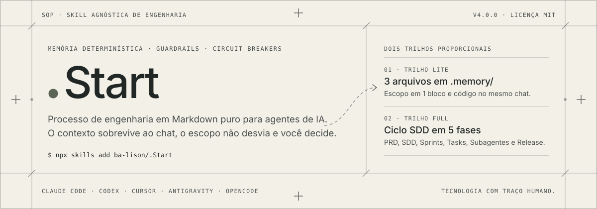
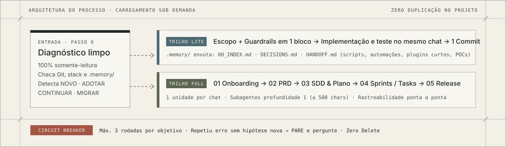

<div align="center">

<picture>
  <source media="(prefers-color-scheme: dark)" srcset="./assets/hero-grafite.svg">
  
</picture>

<br>

[](./skills/start/SKILL.md)
[](./docs/COMO-USAR.md)
[](./LICENSE)
[](#)

</div>

---

## O problema que o `.Start` resolve

Agentes de IA escrevem código rápido, mas esquecem decisões quando o chat vira, alteram arquivos fora do combinado e entram em loop tentando consertar o mesmo erro.

Na **v4.0**, o `.Start` deixou de ser uma pasta de 39 arquivos copiada dentro de cada projeto e virou uma **Skill agnóstica modular** ([`skills/start/`](./skills/start/)). O motor fica instalado nas skills do seu agente; no repositório do seu produto entra apenas a pasta `.memory/` com o que realmente pertence ao projeto.

- **Memória que sobrevive ao chat:** estado atual, decisões e handoffs ficam em `.memory/` e são conferidos contra o `git status` real na abertura de cada sessão.
- **Você decide o que importa:** escopo, arquitetura, schema, dependências, segurança e exclusões exigem sua confirmação e ficam registrados em `DECISIONS.md`.
- **Circuit breaker anti-loop:** teto padrão de **3 rodadas** por objetivo (tentar + verificar). Se o erro se repetir sem hipótese nova, o agente para, registra o bloqueio e pergunta.
- **Subagentes sob controle:** profundidade máxima 1, arquivos permitidos isolados e relatório limitado a **500 caracteres** para proteger o contexto principal.

---

## Começar em 30 segundos

### 1. Instale a skill

```bash
npx skills add ba-lison/.Start
```

Prefere instalar manualmente sem CLI? Copie [`skills/start`](./skills/start/) para `.claude/skills/start` (no projeto ou na sua pasta global `~/.claude/skills/start`) e crie o atalho agnóstico para `.agents/skills` conforme o [guia de instalação](./docs/COMO-USAR.md).

### 2. Acione no seu projeto

Abra o **Claude Code**, **Codex**, **Cursor**, **Antigravity** ou **OpenCode** na pasta do repositório e envie:

```text
/start
```

*(No Codex: `$start` · Ou em texto livre: `"Iniciar projeto com a skill start"` / `"Continuar projeto"`).*

O agente faz um diagnóstico **100% somente-leitura** antes de tocar em qualquer arquivo, detecta o modo certo e pede sua confirmação.

---

## Dois trilhos proporcionais ao projeto

Nem todo código precisa de cinco fases formais. Na entrada, o agente recomenda o trilho pelo tamanho real do trabalho — e carrega apenas os templates daquele trilho sob demanda:

<picture>
  <source media="(prefers-color-scheme: dark)" srcset="./assets/arquitetura-grafite.svg">
  
</picture>

| Critério | Trilho `LITE` *(Rápido)* | Trilho `FULL` *(SDD Completo)* |
| :--- | :--- | :--- |
| **Quando usar** | Scripts, automações, CLIs, plugins curtos, POCs e features de 1 a 3 sessões | SaaS, sistemas médios/grandes, múltiplos módulos ou operação compartilhada/crítica |
| **Arquivos em `.memory/`** | **Apenas 3:** `00_INDEX.md`, `DECISIONS.md` e `HANDOFF.md` | Estrutura completa sob demanda (`PRD`, `SDD`, `DELIVERY`, `BUILDS`, `SPRINTS`, `TASKS`, `RELEASES`) |
| **Guardrails na largada** | Confirmados junto com o mini-escopo em **1 única mensagem** | Confirmados em **1 bloco único** na unidade `ONBOARDING` |
| **Ritmo de execução** | Planeja e já implementa no mesmo chat após o seu *"Aprovo"* | 1 unidade atômica por chat (`Task` ou `Sprint` orquestrada com subagentes) |
| **Fechamento Git** | 1 commit local limpo por entrega | 1 commit local atômico por unidade + rastreabilidade de Release |

---

## Quatro modos automáticos de entrada

| O que o agente encontra na pasta | Modo | Como age |
| :--- | :--- | :--- |
| Pasta vazia / projeto do zero | **`NOVO`** | Confirma trilho (`LITE` ou `FULL`) + guardrails e estrutura `.memory/` e `AGENTS.md` |
| Código existente sem `.memory/` | **`ADOTAR`** | Faz diagnóstico somente-leitura (stack, comandos reais, Git, riscos) sem mover nem apagar nada |
| `.memory/` ativa | **`CONTINUAR`** | Confere `git status` e `HEAD` contra o último handoff antes de anunciar o próximo passo |
| Versão antiga (`.start/` v3 ou `docs/` v2) | **`MIGRAR`** | Migra com `git mv` e política *Zero Delete* (arquivos substituídos vão intactos para `_backup_original/`) |

---

## Skills complementares recomendadas

O `.Start` roda sozinho sem dependências externas. Se quiser enxugar ainda mais o código gerado e a leitura de repositórios grandes, combine-o com estas duas skills abertas:

| Skill | Repositório | Por que combina com o `.Start` |
| :--- | :--- | :--- |
| **Ponytail** | [`DietrichGebert/ponytail`](https://github.com/DietrichGebert/ponytail) | Disciplina de desenvolvedor sênior enxuto: menor mudança que resolve a tarefa inteira, zero abstração prematura e 1–2 linhas finais apontando riscos e o que não foi verificado. |
| **Graphify** | [`Graphify-Labs/graphify`](https://github.com/Graphify-Labs/graphify) | Constrói o grafo arquitetural do código via AST (`--no-viz` → `GRAPH_REPORT.md`), poupando tokens na etapa de diagnóstico de projetos médios e grandes no modo `ADOTAR`. |

---

## O que há neste repositório

```text
.Start/
├── skills/
│   └── start/                  # A skill agnóstica v4.0 (SKILL.md + references/ + templates/)
├── docs/
│   ├── COMO-USAR.md            # Guia direto de instalação, uso e convivência com workspaces
│   ├── exemplos/               # Exemplo completo de memória preenchida do início à Release
│   └── pesquisas/              # Biblioteca técnica que fundamentou cada regra do processo
├── assets/                     # Pranchas visuais e assinatura (temas claro e escuro)
└── LICENSE                     # Licença MIT
```

- **Guia prático:** [`docs/COMO-USAR.md`](./docs/COMO-USAR.md)
- **Exemplo de `.memory/` completa:** [`docs/exemplos/full-sdd/`](./docs/exemplos/full-sdd/)
- **Biblioteca de pesquisas (Memória de Agentes, Build/Release, DORA, SDD e Circuit Breakers):** [`docs/pesquisas/`](./docs/pesquisas/)
- **Versão anterior em pasta (`.start/` v3.0.0):** preservada integralmente na tag Git [`v3.0.0`](https://github.com/ba-lison/.Start/tree/v3.0.0)

---

## Licença

Distribuído sob a licença [**MIT**](./LICENSE). Uso livre em projetos pessoais e comerciais.

<br>

<div align="center">

<a href="https://github.com/ba-lison">
  <picture>
    <source media="(prefers-color-scheme: dark)" srcset="./assets/assinatura-grafite.svg">
    
  </picture>
</a>

<br>
<sub>Tecnologia com traço humano.</sub>

</div>
