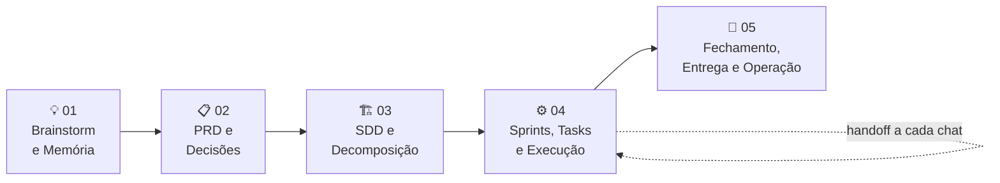

<div align="center">

# ⚡ .Start

### O sistema operacional de processo para projetos feitos com agentes de IA

*Copie uma pasta, escreva uma frase, e o seu agente passa a trabalhar com memória, guardrails e método.*

<br>

[](./00-SOP-SISTEMA-OPERACIONAL-PROCESSO/.start/CHANGELOG-START.md)
[](./LICENSE)
[](#)
[](#)

<br>

**Funciona com** &nbsp; Claude Code · Codex · Cursor · OpenCode · Antigravity · qualquer LLM que leia Markdown

<br>

[🚀 Começar](#-começar-em-30-segundos) &nbsp;•&nbsp;
[🧭 Como funciona](#-como-funciona) &nbsp;•&nbsp;
[🛡️ Guardrails](#️-guardrails-você-decide-o-que-o-agente-pode-fazer) &nbsp;•&nbsp;
[📚 Biblioteca](#-biblioteca-de-fundamentação) &nbsp;•&nbsp;
[📄 Licença](#-licença)

</div>

---

## 🤔 Por que existe

Agentes de IA escrevem código rápido, mas esquecem tudo a cada chat, tomam decisões sozinhos, entram em loop e perdem o fio do projeto quando o contexto enche.

O **.Start** resolve isso com um processo escrito em Markdown puro, que qualquer agente lê e segue:

<table>
<tr>
<td width="50%" valign="top">

### 🧠 Memória que sobrevive ao chat
Tudo o que importa fica em `.memory/` dentro do projeto: contexto, decisões, PRD, SDD, sprints, tasks e handoffs. O próximo chat continua de onde o anterior parou.

</td>
<td width="50%" valign="top">

### 🛡️ Guardrails que você aprova
Um questionário de 7 perguntas define o que o agente pode e não pode fazer. Nenhuma decisão estrutural acontece sem você.

</td>
</tr>
<tr>
<td width="50%" valign="top">

### 🔁 Circuit breakers anti-loop
Limite de rodadas por objetivo, de subagentes por chat e de tamanho de relatório. Quando bate o limite, o agente para e pergunta.

</td>
<td width="50%" valign="top">

### 🧩 Um chat, uma unidade de trabalho
Cada chat entrega uma Task e termina com um handoff e o prompt do próximo chat. Sem contexto degradado, sem trabalho perdido.

</td>
</tr>
</table>

---

## 🚀 Começar em 30 segundos

**1.** Copie **só** a pasta do kit para a raiz do seu projeto:

```text
00-SOP-SISTEMA-OPERACIONAL-PROCESSO/.start/   →   seu-projeto/.start/
```

**2.** Abra um chat novo na sua ferramenta de IA, com o projeto como pasta de trabalho, e escreva:

```text
Leia .start/INICIO.md e siga.
```

**3.** Pronto. O agente identifica a situação do projeto, confirma com você e conduz o resto.

> [!TIP]
> No fim de cada chat o agente entrega o prompt do próximo. Daí em diante basta abrir um chat novo e colar (ou só escrever **"Continue"**).

> [!WARNING]
> Não copie a pasta `.Start` inteira para o projeto. A biblioteca de pesquisas confundiria o agente, que poderia tratá-la como regra do projeto.

📖 Guia completo: [**COMO-USAR.md**](./00-SOP-SISTEMA-OPERACIONAL-PROCESSO/COMO-USAR.md)

---

## 🧭 Como funciona

### Quatro modos de entrada

O roteador [`INICIO.md`](./00-SOP-SISTEMA-OPERACIONAL-PROCESSO/.start/INICIO.md) olha o projeto e escolhe o caminho:

| O agente encontra | Modo | O que acontece |
| :--- | :---: | :--- |
| 📭 Pasta vazia | [**NOVO**](./00-SOP-SISTEMA-OPERACIONAL-PROCESSO/.start/MODO-NOVO.md) | Guardrails → contexto → PRD |
| 📦 Código existente, sem `.memory/` | [**ADOTAR**](./00-SOP-SISTEMA-OPERACIONAL-PROCESSO/.start/MODO-ADOTAR.md) | Diagnóstico só de leitura → plano em partes |
| 🔧 Memória antiga ou incompleta | [**AJUSTAR**](./00-SOP-SISTEMA-OPERACIONAL-PROCESSO/.start/MODO-AJUSTAR.md) | Auditoria → migração com sua autorização |
| ✅ `.memory/` em dia | [**CONTINUAR**](./00-SOP-SISTEMA-OPERACIONAL-PROCESSO/.start/MODO-CONTINUAR.md) | Lê o último handoff e propõe o próximo passo |

### Cinco fases, da ideia à operação



| Fase | Documento |
| :---: | :--- |
| 01 | [Brainstorm e Memória](./00-SOP-SISTEMA-OPERACIONAL-PROCESSO/.start/FASE-01-BRAINSTORM-E-MEMORIA.md) |
| 02 | [PRD e Decisões](./00-SOP-SISTEMA-OPERACIONAL-PROCESSO/.start/FASE-02-PRD-E-DECISOES.md) |
| 03 | [SDD e Decomposição](./00-SOP-SISTEMA-OPERACIONAL-PROCESSO/.start/FASE-03-SDD-E-DECOMPOSICAO.md) |
| 04 | [Sprints, Tasks e Execução](./00-SOP-SISTEMA-OPERACIONAL-PROCESSO/.start/FASE-04-SPRINTS-TASKS-EXECUCAO.md) |
| 05 | [Fechamento, Entrega e Operação](./00-SOP-SISTEMA-OPERACIONAL-PROCESSO/.start/FASE-05-FECHAMENTO-ENTREGA-OPERACAO.md) |

### O que o agente cria no seu projeto

```text
seu-projeto/
├── AGENTS.md                  ← entrada única, lida a cada chat
├── .start/                    ← o kit (versionado junto, nunca editado)
└── .memory/
    ├── 00_INDEX.md            ← mapa da memória
    ├── PROJECT_GUARDRAILS.md  ← o que o agente pode e não pode fazer
    ├── PROJECT_CONTEXT.md     ← o que é o projeto
    ├── DECISIONS.md           ← decisões registradas (DEC-xx)
    ├── CHANGELOG.md
    └── TASKS/                 ← tasks, handoffs, builds e releases
```

> Ferramentas que pedem um arquivo próprio (`CLAUDE.md`, `.agents/rules/`) recebem só um ponteiro de uma linha para o `AGENTS.md`. Detalhes em [TEMPLATE_PONTEIROS.md](./00-SOP-SISTEMA-OPERACIONAL-PROCESSO/.start/TEMPLATES/TEMPLATE_PONTEIROS.md).

---

## 🛡️ Guardrails: você decide o que o agente pode fazer

Todo onboarding começa por um [questionário de 7 perguntas](./00-SOP-SISTEMA-OPERACIONAL-PROCESSO/.start/QUESTIONARIO-GUARDRAILS.md), uma por vez, cada uma com o padrão e a recomendação. Os padrões:

| Parâmetro | Padrão |
| :--- | :--- |
| Unidade de trabalho por chat | 1 Task |
| Troca de chat | Quando o contexto compactar ou passar de 40 mensagens |
| Subagentes por chat | Até 10 · subagente nunca cria subagente 🔒 |
| Relatório de subagente | Até 500 caracteres |
| Tentativas por objetivo | Até 3 rodadas, somando agente, subagentes e chats |
| Decisões | Uma pergunta por vez · nenhuma decisão sem você 🔒 |
| Git | Commit local automático · push, PR e deploy só com autorização |

🔒 = regra fixa. Regras completas em [GUARDRAILS-E-CIRCUIT-BREAKERS.md](./00-SOP-SISTEMA-OPERACIONAL-PROCESSO/.start/GUARDRAILS-E-CIRCUIT-BREAKERS.md) e [CONTRATO-SUBAGENTE.md](./00-SOP-SISTEMA-OPERACIONAL-PROCESSO/.start/CONTRATO-SUBAGENTE.md).

---

## 🗂️ O que tem neste repositório

```text
.Start/
├── 00-SOP-SISTEMA-OPERACIONAL-PROCESSO/   ⚡ o processo
│   ├── .start/                            ← O KIT: é isto que vai para o projeto
│   │   ├── INICIO.md                      ← roteador de entrada
│   │   ├── PROTOCOLO_MESTRE_EXECUCAO.md
│   │   ├── MODO-*.md · FASE-*.md
│   │   └── TEMPLATES/                     ← 22 templates (PRD, SDD, Task, Handoff…)
│   ├── COMO-USAR.md                       ← guia para humanos
│   └── pesquisas-de-embasamento/
├── 01-memoria-agentes-ia/                 🧠 memória persistente e RAG
├── 02-build-release-engineering/          ⚙️ build, CI/CD, release e DORA
├── 03-especificacoes-documentacao-sdlc/   📝 SDD, PRD e documentação
├── 04-pesquisas-v2/                       🔬 pesquisas que fundamentaram a V2/V3
└── 05-exemplo-projeto-simple/             🧪 exemplo completo, do 1º chat à Release
```

👉 Quer ver o kit em ação? Abra o [**exemplo de projeto**](./05-exemplo-projeto-simple/README.md): a memória inteira de um projeto real, da primeira conversa à Release.

---

## 📚 Biblioteca de fundamentação

Cada regra do kit tem pesquisa por trás. A biblioteca é material de consulta: ela **não** vai para os projetos.

<details>
<summary><b>⚡ Pesquisas de embasamento do processo</b></summary>
<br>

- [Circuit Breakers e Anti-Looping em Agentes Orquestradores](./00-SOP-SISTEMA-OPERACIONAL-PROCESSO/pesquisas-de-embasamento/Circuit-Breakers-e-Anti-Looping-em-Agentes-Orquestradores.md)
- [Esteira Moderna de Entrega de Software: da Demanda à Produção](./00-SOP-SISTEMA-OPERACIONAL-PROCESSO/pesquisas-de-embasamento/Esteira-Moderna-de-Entrega-Software-Demanda-a-Producao.md)
- [Padrão Orchestrator-Worker de Profundidade 1 contra Degradação de Contexto](./00-SOP-SISTEMA-OPERACIONAL-PROCESSO/pesquisas-de-embasamento/Padrao-Orchestrator-Worker-Profundidade-1-Anti-Degradacao-Contexto.md)
- [Protocolo de Micro-Handoff Determinístico e Memory Bank](./00-SOP-SISTEMA-OPERACIONAL-PROCESSO/pesquisas-de-embasamento/Protocolo-Micro-Handoff-Deterministico-e-Memory-Bank.md)
- [Sprint no Desenvolvimento de Software: Scrum e Métodos Ágeis](./00-SOP-SISTEMA-OPERACIONAL-PROCESSO/pesquisas-de-embasamento/Sprint-no-Desenvolvimento-de-Software-Scrum-Metodos-Ageis.md)
- [Backlog de pesquisas](./00-SOP-SISTEMA-OPERACIONAL-PROCESSO/BACKLOG-PESQUISAS-V2.md) · [Pesquisas da V2 e matriz de decisões](./04-pesquisas-v2/README.md)

</details>

<details>
<summary><b>🧠 Memória persistente e RAG para agentes de IA</b></summary>
<br>

**Arquitetura e conceitos**
- [Arquitetura de Memória Persistente para Projetos de Software com Agente de IA](./01-memoria-agentes-ia/01-arquitetura-e-conceitos/Arquitetura%20de%20Mem%C3%B3ria%20Persistente%20para%20Projetos%20de%20Software%20com%20Agente%20de%20IA.md)
- [Arquitetura de memória de projeto com grafo de conhecimento temporal](./01-memoria-agentes-ia/01-arquitetura-e-conceitos/Arquitetura%20de%20mem%C3%B3ria%20de%20projeto%20com%20grafo%20de%20conhecimento%20temporal%20para%20agentes%20de%20IA.md)
- [Mapeamento de Repositórios GitHub: Memória Persistente para Agentes de IA 2026](./01-memoria-agentes-ia/01-arquitetura-e-conceitos/Mapeamento%20de%20Repositorios%20GitHub%20-%20Memoria%20Persistente%20para%20Agentes%20de%20IA%202026.md)
- [Memória Persistente para Agentes de IA em Projetos de Software](./01-memoria-agentes-ia/01-arquitetura-e-conceitos/Mem%C3%B3ria%20Persistente%20para%20Agentes%20de%20IA%20em%20Projetos%20de%20Software.md)
- [Memória de Agente de IA: RAG, Memória Persistente, Fine-tuning e Além](./01-memoria-agentes-ia/01-arquitetura-e-conceitos/Mem%C3%B3ria%20de%20Agente%20de%20IA%20para%20Projetos%20de%20Software%20%E2%80%94%20RAG%2C%20Mem%C3%B3ria%20Persistente%2C%20Fine-tuning%20e%20Al%C3%A9m.md)
- [Integração com Agentes de Código](./01-memoria-agentes-ia/01-arquitetura-e-conceitos/Pesquisa-Integracao-com-Agentes-de-Codigo.md)
- [Working Context vs Memória de Projeto](./01-memoria-agentes-ia/01-arquitetura-e-conceitos/Working%20Context%20vs%20Mem%C3%B3ria%20de%20Projeto%20%E2%80%94%20An%C3%A1lise%20Conceitual%20das%20Camadas%20de%20Mem%C3%B3ria%20em%20Agentes%20de%20IA.md)
- [Orquestração de Subagentes em Coding Agents](./01-memoria-agentes-ia/01-arquitetura-e-conceitos/Orquestracao-de-Subagentes-em-Coding-Agents.md)

**Implementação e ferramentas**
- [Especificação do comando memory-curator](./01-memoria-agentes-ia/02-implementacao-e-ferramentas/Especifica%C3%A7%C3%A3o%20Completa%20%E2%80%94%20Comando%20memory-curator%20para%20Agentes%20de%20IA%20em%20Projetos%20de%20Software.md)
- [Estrutura .memory](./01-memoria-agentes-ia/02-implementacao-e-ferramentas/Estrutura%20.memory%20%E2%80%94%20Mem%C3%B3ria%20Persistente%20de%20Projeto%20para%20Agentes%20de%20IA.md)
- [Memória com Embeddings e Vector Store](./01-memoria-agentes-ia/02-implementacao-e-ferramentas/Mem%C3%B3ria%20de%20Projeto%20com%20Embeddings%20e%20Vector%20Store%20%E2%80%94%20Implementa%C3%A7%C3%A3o%20Intermedi%C3%A1ria%20para%20Agente%20de%20Programa%C3%A7%C3%A3o.md)
- [Memória com Git + Markdown + JSONL](./01-memoria-agentes-ia/02-implementacao-e-ferramentas/Mem%C3%B3ria%20de%20Projeto%20com%20Git%20%2B%20Markdown%20%2B%20JSONL.md)
- [Ranking Técnico de Repositórios para Memória de Projeto](./01-memoria-agentes-ia/02-implementacao-e-ferramentas/Ranking%20T%C3%A9cnico%20%E2%80%94%20Reposit%C3%B3rios%20GitHub%20para%20Mem%C3%B3ria%20de%20Projeto%20em%20Agentes%20de%20IA.md)

**Segurança e benchmarks**
- [Metodologia de Avaliação de Memória Persistente](./01-memoria-agentes-ia/03-seguranca-e-benchmarks/Metodologia%20de%20Avalia%C3%A7%C3%A3o%20de%20Mem%C3%B3ria%20Persistente%20de%20Projeto%20para%20Agentes%20de%20IA.md)
- [Segurança em Sistemas de Memória Persistente: Riscos e Mitigações](./01-memoria-agentes-ia/03-seguranca-e-benchmarks/Seguran%C3%A7a%20em%20Sistemas%20de%20Mem%C3%B3ria%20Persistente%20para%20Agentes%20de%20IA%20%E2%80%94%20Riscos%2C%20Mitiga%C3%A7%C3%B5es%20e%20Matriz%20de%20Risco.md)

**Documentação oficial**
- [Anthropic: memória, ferramentas e padrões](./01-memoria-agentes-ia/04-documentacao-oficial/Documenta%C3%A7%C3%A3o%20Oficial%20da%20Anthropic%20%E2%80%94%20Mem%C3%B3ria%20Persistente%2C%20Ferramentas%20e%20Padr%C3%B5es%20para%20Agentes%20com%20Mem%C3%B3ria.md)
- [OpenAI: memória, contexto e recuperação](./01-memoria-agentes-ia/04-documentacao-oficial/Documenta%C3%A7%C3%A3o%20Oficial%20OpenAI%20%E2%80%94%20Mem%C3%B3ria%2C%20Contexto%20e%20Recupera%C3%A7%C3%A3o%20de%20Informa%C3%A7%C3%A3o.md)
- [Google Vertex AI: memória de agentes](./01-memoria-agentes-ia/04-documentacao-oficial/Recursos%20Oficiais%20Google%20Vertex%20AI%20para%20Mem%C3%B3ria%20de%20Agentes.md)

</details>

<details>
<summary><b>⚙️ Build & Release Engineering</b></summary>
<br>

**Builds e compilação**
- [Arquitetura e Estrutura de Build em Projetos Profissionais](./02-build-release-engineering/01-builds-e-compilacao/Arquitetura%20e%20Estrutura%20de%20Build%20em%20Projetos%20Profissionais%20de%20Software.md)
- [Builds Determinísticas, Reproduzíveis, Herméticas e Repetíveis](./02-build-release-engineering/01-builds-e-compilacao/Builds-Deterministicas-Reproduziveis-Hermeticas-e-Repetiveis.md)
- [Estratégias de Deployment, Release e Feature Flags](./02-build-release-engineering/01-builds-e-compilacao/Guia-Estrategias-de-Deployment-Release-Feature-Flags.md)
- [Gerenciamento e Ciclo de Vida de Artefatos](./02-build-release-engineering/01-builds-e-compilacao/Guia-Gerenciamento-e-Ciclo-de-Vida-de-Artefatos.md)
- [Métricas de Engenharia: DORA e CI/CD](./02-build-release-engineering/01-builds-e-compilacao/Guia-Metricas-de-Engenharia-DORA-CI-CD.md)
- [Processo de Release, RACI e Governança](./02-build-release-engineering/01-builds-e-compilacao/Guia-Processo-de-Release-RACI-e-Governanca-v2.md)
- [Promoção de Artefatos e Matriz de Ambientes](./02-build-release-engineering/01-builds-e-compilacao/Guia-Promocao-de-Artefatos-e-Matriz-de-Ambientes.md)
- Prompts de pesquisa: [modelo operacional](./02-build-release-engineering/01-builds-e-compilacao/Prompt-Modelo-Operacional-Build-Engineering-Contextualizado.md) · [estrutura de build](./02-build-release-engineering/01-builds-e-compilacao/Prompt-Pesquisa-Arquitetura-Estrutura-Build.md) · [pipelines CI](./02-build-release-engineering/01-builds-e-compilacao/Prompt-Pesquisa-Arquitetura-Pipelines-CI.md) · [desktop e plugins CAD](./02-build-release-engineering/01-builds-e-compilacao/Prompt-Pesquisa-Build-Release-Desktop-CAD-Plugins.md) · [builds reproduzíveis](./02-build-release-engineering/01-builds-e-compilacao/Prompt-Pesquisa-Builds-Deterministicas-e-Reproduziveis.md) · [regras de fontes](./02-build-release-engineering/01-builds-e-compilacao/Prompt-Pesquisa-Diretrizes-e-Regras-de-Fontes-v2.md) · [branching e CI](./02-build-release-engineering/01-builds-e-compilacao/Prompt-Pesquisa-Estrategias-Branching-e-CI-v2.md) · [progressive delivery](./02-build-release-engineering/01-builds-e-compilacao/Prompt-Pesquisa-Estrategias-Deployment-Progressive-Delivery.md) · [supply chain](./02-build-release-engineering/01-builds-e-compilacao/Prompt-Pesquisa-Seguranca-Cadeia-de-Suprimentos-Software.md) · [versionamento](./02-build-release-engineering/01-builds-e-compilacao/Prompt-Pesquisa-Versionamento-Software-e-Releases.md) · [vocabulário](./02-build-release-engineering/01-builds-e-compilacao/Prompt-Pesquisa-Vocabulario-e-Ciclo-Build-Deploy-Release.md)

**Branching, CI/CD e pipelines**
- [Estratégias de Branching, Integração Contínua e Manutenção](./02-build-release-engineering/02-branching-ci-cd-e-pipelines/Estrategias-de-Branching-Integracao-Continua-e-Manutencao.md)
- [Rollback, Roll-forward e Resposta a Incidentes](./02-build-release-engineering/02-branching-ci-cd-e-pipelines/Rollback%2C%20Roll-forward%20e%20Resposta%20a%20Incidentes%20em%20Releases.md)
- [Vocabulário e Ciclo de Build, Distribuição, Deploy e Release](./02-build-release-engineering/02-branching-ci-cd-e-pipelines/Vocabulario-e-Ciclo-de-Build-Distribuicao-Deploy-Release.md)
- [Prompt: Gerenciamento de Artefatos e Pacotes](./02-build-release-engineering/02-branching-ci-cd-e-pipelines/Prompt-Pesquisa-Gerenciamento-Artefatos-e-Pacotes.md)

**Release, deploy e rollback**
- [Build e Release para Aplicações Desktop e Plugins CAD](./02-build-release-engineering/03-release-deploy-e-rollback/Build%20e%20Release%20Engineering%20para%20Aplica%C3%A7%C3%B5es%20Desktop%20e%20Plugins%20CAD.md)
- [Estratégias de Build, Release e Progressive Delivery](./02-build-release-engineering/03-release-deploy-e-rollback/Estrategias%20de%20Build%2C%20Release%20e%20Progressive%20Delivery%20-%20Pesquisa%20Aprofundada%20PESQUISAS%209-16.md)
- [Pipelines de Release, Ambientes e Promoção de Artefatos](./02-build-release-engineering/03-release-deploy-e-rollback/Pipelines%20de%20Release%2C%20Ambientes%20e%20Promo%C3%A7%C3%A3o%20de%20Artefatos.md)
- [Versionamento de Software: Estratégias e Política Corporativa](./02-build-release-engineering/03-release-deploy-e-rollback/Versionamento%20de%20Software%20%E2%80%94%20Estrat%C3%A9gias%20e%20Pol%C3%ADtica%20Corporativa.md)
- Prompts: [pipelines e promoção](./02-build-release-engineering/03-release-deploy-e-rollback/Prompt-Pesquisa-Pipelines-Release-e-Promocao-v2.md) · [rollback e incidentes](./02-build-release-engineering/03-release-deploy-e-rollback/Prompt-Pesquisa-Rollback-Rollforward-Resposta-Incidentes.md)

**Segurança, banco de dados e governança**
- [Segurança da Cadeia de Suprimentos de Software](./02-build-release-engineering/04-seguranca-e-supply-chain/Seguran%C3%A7a%20da%20Cadeia%20de%20Suprimentos%20de%20Software%20%E2%80%94%20Amea%C3%A7as%20e%20Controles%20de%20Build%2C%20Depend%C3%AAncias%2C%20Pipelines%2C%20Artefatos%20e%20Distribui%C3%A7%C3%A3o.md)
- [Migrações e Setup no Supabase Cloud](./02-build-release-engineering/05-banco-de-dados-e-migracoes/01-Guia-Oficial-Migracoes-e-Setup-Supabase-Cloud.md)
- [Migrações de Banco de Dados durante Releases](./02-build-release-engineering/05-banco-de-dados-e-migracoes/Migra%C3%A7%C3%B5es%20de%20banco%20de%20dados%2C%20schemas%20e%20dados%20durante%20releases%20de%20software.md) · [prompt](./02-build-release-engineering/05-banco-de-dados-e-migracoes/Prompt-Pesquisa-Migracoes-Banco-de-Dados-em-Releases.md)
- [Modelo Operacional de Build, Release, Segurança e Governança](./02-build-release-engineering/06-metricas-e-governanca/Modelo%20operacional%20de%20build%2C%20release%2C%20seguran%C3%A7a%20e%20governan%C3%A7a%20para%20equipe%20de%20engenharia.md) · [prompt DORA](./02-build-release-engineering/06-metricas-e-governanca/Prompt-Pesquisa-Metricas-Build-CI-DORA.md)

</details>

<details>
<summary><b>📝 Especificações, SDLC e documentação</b></summary>
<br>

- [PR, PRD, SDD, IA no SDLC e Vibe Coding: Guia Completo](./03-especificacoes-documentacao-sdlc/01-spec-driven-development-sdd/PR%2C%20PRD%2C%20SDD%2C%20IA%20no%20SDLC%20e%20Vibe%20Coding%20%E2%80%94%20Guia%20Completo%20para%20Engenharia%20Moderna.md)
- [Spec-Driven Development (SDD) no desenvolvimento com IA](./03-especificacoes-documentacao-sdlc/01-spec-driven-development-sdd/Spec-Driven%20Development%20%28SDD%29%20na%20engenharia%20de%20software%20contempor%C3%A2nea%20e%20no%20desenvolvimento%20com%20IA.md)
- [Termos Modernos de IA e Desenvolvimento de Software 2024–2026](./03-especificacoes-documentacao-sdlc/01-spec-driven-development-sdd/Termos-Modernos-IA-e-Desenvolvimento-de-Software-2024-2026.md)
- [PRDs Modernos para Produtos Digitais e IA](./03-especificacoes-documentacao-sdlc/02-prd-e-requisitos-produtos/PRDs%20modernos%20para%20produtos%20digitais%20e%20IA%20%E2%80%94%20s%C3%ADntese%20acad%C3%AAmica%2C%20industrial%20e%20orientada%20a%20LLMs.md)
- [Documentação em Desenvolvimento de Software: Guia Profissional e Acadêmico](./03-especificacoes-documentacao-sdlc/03-sdlc-e-documentacao-tecnica/Documenta%C3%A7%C3%A3o%20em%20Desenvolvimento%20de%20Software%20%E2%80%94%20Guia%20Profissional%20e%20Acad%C3%AAmico.md)
- [Glossário Consolidado de Metodologias, Práticas e Standards](./03-especificacoes-documentacao-sdlc/03-sdlc-e-documentacao-tecnica/Glossario-Consolidado-Metodologias-Praticas-e-Standards.md)

</details>

---

## 🔄 Atualizar o kit num projeto

Substitua a pasta `.start/` do projeto pela versão nova e diga `Leia .start/INICIO.md e siga.` O agente entra no modo **AJUSTAR**, mostra o que mudou e registra a troca. Histórico de versões em [CHANGELOG-START.md](./00-SOP-SISTEMA-OPERACIONAL-PROCESSO/.start/CHANGELOG-START.md).

---

## 📄 Licença

Distribuído sob a licença **MIT**. Use, copie, adapte e compartilhe à vontade, inclusive em projetos comerciais. Veja [LICENSE](./LICENSE).

<div align="center">

<br>

Feito por **[Alison Cruz](https://github.com/ba-lison)** 🇧🇷

*Se o .Start te ajudou, deixa uma ⭐ no repositório.*

</div>
